# SGC-Redes — Fluxos de uso

Este documento mostra cada fluxo do sistema:
- quem faz cada etapa;
- em que tela ela acontece;
- que parte do código cuida dela;
- o que ela produz.

Ele serve a dois públicos:
- **Quem usa** (Coordenação, docentes, CTP, Direção e Assistência Estudantil): leia os diagramas e a coluna "Tela".
- **Quem mantém o código**: veja a coluna "Parte do sistema" e as seções de gargalos.

A mesma informação aparece, resumida, na **Ajuda** do sistema (`/ajuda`). Ali cada etapa do diagrama tem o link "Onde:", que abre a tela. O manual (`docs/MANUAL_DO_USUARIO.md`) é gerado a partir da Ajuda, com os mesmos diagramas.

**Cores dos diagramas:**
- verde: Coordenação e gestão;
- azul: docência;
- âmbar: setores (Assistência Estudantil, nutricionista, interessados);
- cinza: o próprio sistema.

O verde e o azul são as mesmas cores da tela de quem acumula cargo e docência.

**Sumário**

1. [Mapa geral do ano](#1-mapa-geral-do-ano)
2. [Acesso e tela inicial](#2-acesso-e-tela-inicial)
3. [Preparação do ano letivo](#3-preparação-do-ano-letivo)
4. [Ausência docente, cobertura e convites](#4-ausência-docente-cobertura-e-convites)
5. [Alimentação](#5-alimentação)
6. [Comunicação semiautomática](#6-comunicação-semiautomática)
7. [PPE e PEI](#7-ppe-e-pei)
8. [PPI (40 horas)](#8-ppi-40-horas)
9. [Diários](#9-diários)
10. [Processos SEI](#10-processos-sei)
11. [Relatórios](#11-relatórios)
12. [Cargo e docência](#12-cargo-e-docência)
13. [Camadas comuns a todos os fluxos](#13-camadas-comuns-a-todos-os-fluxos)
14. [Análise de gargalos (25/11/2026)](#14-análise-de-gargalos-25112026)

---

## 1. Mapa geral do ano

Os módulos dependem uns dos outros, e quase tudo parte da grade.
- A **grade** depende das ofertas, que dependem dos cadastros.
- As **ausências** usam a grade e o calendário para saber quais aulas a pessoa teria.
- A **alimentação** reage às ausências.
- A **comunicação** fecha cada fluxo.

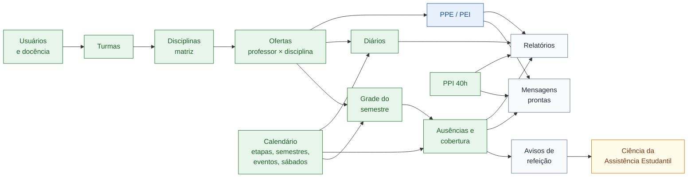

A tela inicial (`/painel`) acompanha todo o ano. Ela avisa a cada perfil o que falta em cada elo: etapas, datas do semestre, disciplinas sem professor, turmas sem grade, ausências, convites, PPE, PEI, diários e processos.

---

## 2. Acesso e tela inicial

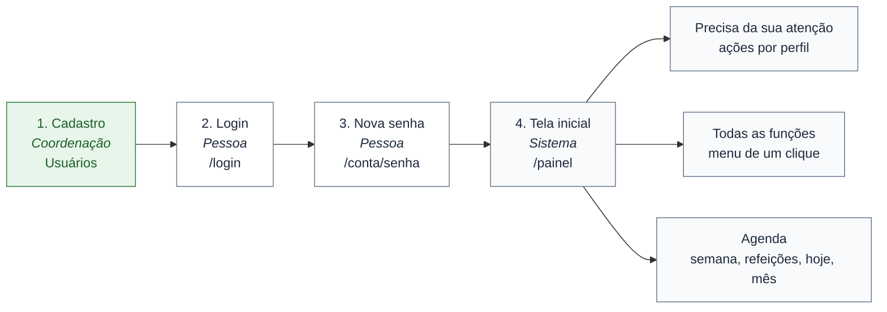

| # | Etapa | Responsável | Tela | Parte do sistema | Resultado |
| :-- | :-- | :-- | :-- | :-- | :-- |
| 1 | Cadastro da conta | Coordenação | Cadastros › Usuários | `src/app/(painel)/usuarios/actions.ts`, `src/lib/usuarios/regras.ts` | Conta com senha provisória e, se for o caso, a marca "Também leciona" |
| 2 | Login | Pessoa | `/login` | `src/app/login/actions.ts`, `src/lib/auth/sessao.ts` | Sessão de 8 horas; bloqueio de 15 minutos após 5 tentativas erradas |
| 3 | Troca da senha provisória | Pessoa | Alterar senha | `src/app/(painel)/conta/senha/actions.ts`, `src/lib/auth/dal.ts` (`exigirUsuario`) | Senha própria; até a troca, nenhuma outra página abre |
| 4 | Tela inicial | Sistema | Início | `src/app/(painel)/painel/page.tsx` | Ver a seguir |

Detalhes da tela inicial:
- **Ações prioritárias:**
  - `src/lib/painel/servidor.ts` (`contagensDoPainel`) só conta. A conta depende das permissões e, para a docência, das disciplinas da pessoa.
  - `src/lib/painel/acoes.ts` (`montarAcoes`) decide o texto, o nível (urgente, atenção ou acompanhar) e o papel (cargo ou docência).
  - Nada mostra nomes de estudantes (LGPD).
- **Funções:** vêm de `src/lib/navegacao.ts`, a mesma fonte dos menus do cabeçalho.
- **Agenda:** `src/lib/painel/agenda.ts` monta a semana do docente. `src/lib/alimentacao/servidor.ts` (`totaisDoDia`) traz as refeições da Assistência Estudantil. `ausenciasDoDia` traz o bloco "Hoje" da Coordenação.

---

## 3. Preparação do ano letivo

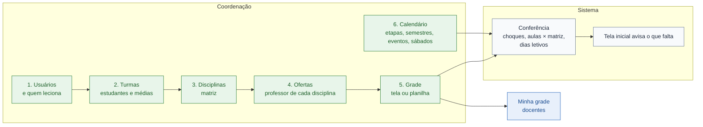

| # | Etapa | Responsável | Tela | Parte do sistema | Resultado |
| :-- | :-- | :-- | :-- | :-- | :-- |
| 1 | Usuários (individual ou planilha) | Coordenação | Cadastros › Usuários | `usuarios/actions.ts`, `usuarios/importar/actions.ts`, `src/lib/importacao/usuarios.ts` | Contas; Professor sempre leciona |
| 2 | Turmas | Coordenação | Cadastros › Turmas | `src/app/(painel)/turmas/actions.ts` | Estudantes ativos e médias de refeição (base da previsão) |
| 3 | Disciplinas | Coordenação | Cadastros › Disciplinas | `src/app/(painel)/disciplinas/actions.ts`, `src/lib/importacao/disciplinas.ts` | Matriz com carga horária e prática obrigatória |
| 4 | Ofertas | Coordenação | Cadastros › Ofertas | `src/app/(painel)/ofertas/actions.ts`, `src/lib/ofertas/regras.ts` (`planejarDistribuicao`), `src/lib/importacao/ofertas.ts` | Professor de cada disciplina por turma e ano; pela planilha, liga a docência de quem recebe disciplina |
| 5 | Grade | Coordenação | Operação › Grade | `src/app/(painel)/grade/actions.ts`, `src/lib/grade/regras.ts`, `src/lib/importacao/grade.ts` | Aulas por dia e bloco, sem choque de professor |
| 6 | Calendário | Coordenação | Calendário › Etapas / Novo evento; Grade › Sábados | `src/app/(painel)/calendario/actions.ts`, `src/lib/calendario/regras.ts` | Etapas N1–N4, datas dos semestres, feriados e sábados letivos |
| — | Conferência e avisos | Sistema | Início | `contagensDoPainel`: `etapasFaltando`, `semestreSemDatas`, `disciplinasSemProfessor`, `turmasSemGrade` | Cartões "Cadastrar", "Distribuir" e "Montar grade" até tudo estar completo |

**Copiar o calendário para o ano seguinte** (Calendário) evita refazer os eventos fixos.

**Avaliações finais** (ROD, Art. 32; decisão G23):
- Nunca contam como dias letivos e não têm aula regular pela grade, inclusive num sábado (`SEMPRE_NAO_LETIVO` em
  `src/lib/calendario/regras.ts`).
- Acontecem só no fim do ano, depois da última semana letiva, também para as disciplinas semestrais.
- O calendário avisa se o período for cadastrado antes do último dia letivo (`avisosAvaliacoesFinais`).
- Refeições nesses dias (G24, aceito): a grade não prevê nenhuma; a Coordenação lança o acréscimo por turma e dia em Alimentação › Acrescentar refeição, e a AE vê o acréscimo na agenda da tela inicial.

---

## 4. Ausência docente, cobertura e convites

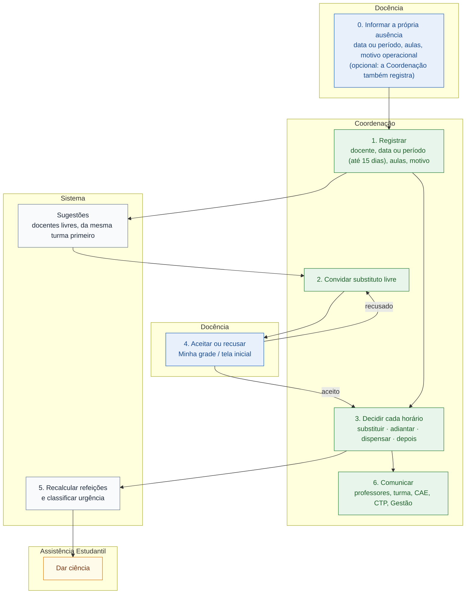

| # | Etapa | Responsável | Tela | Parte do sistema | Resultado |
| :-- | :-- | :-- | :-- | :-- | :-- |
| 0 | Informar a própria ausência (RF02-A) | Docente | Minha grade › Informar ausência (`/ausencias/informar`) | `informarAusencia` (mesma rotina `criarAusencias`), `src/lib/ausencias/opcoes.ts` (`aulasParaRegistro`) | Ausência "Aguardando decisão" com o selo "Informada pelo docente"; a tela inicial da Coordenação conta as informadas. O docente acompanha e pode cancelar em "Minhas ausências" (`cancelarAusenciaInformada`) até a decisão. |
| 1 | Registrar | Coordenação | Ausências › Registrar | `src/app/(painel)/ausencias/actions.ts` (`registrarAusencia`); `src/lib/ausencias/regras.ts` (`datasDoPeriodo`, `agruparAulasEscolhidas`); `src/lib/ausencias/servidor.ts` (`carregarDia`) | Uma ausência por turma, disciplina e dia, com as aulas da grade vigente; feriados e sábados letivos considerados |
| 2 | Convidar | Coordenação | Ausências › detalhe › Convites | `convidarSubstituto`, `sugerirSubstitutos` | Convite pendente, visível ao docente na tela inicial e em Minha grade; mensagem individual pronta |
| 3 | Decidir a cobertura | Coordenação | Ausências › detalhe | `decidirAusencia`, `planejarCoberturas`, `statusDaAusencia` | Cobertura por horário; justificativa obrigatória quando gera emergência (< 4h) |
| 4 | Responder o convite | Docente | Minha grade | `responderConvite` | Aceitar cria a substituição se o horário ainda está aberto e o docente livre |
| 5 | Refeições | Sistema | Alimentação | `recalcularAlertasDaTurma`, `src/lib/alimentacao-engine.ts` | Avisos de cancelamento com urgência verde, amarela ou vermelha |
| 6 | Comunicar | Coordenação | Ausências › detalhe › Comunicar | `src/lib/ausencias/mensagens.ts` (`mensagensDaAusencia`) | Mensagens prontas por público, registradas no histórico |
| 5a | Prazo de reposição (ROD, Art. 37, § 2º) | Sistema | Ausências › detalhe; tela inicial | `prazoDeReposicao` (`src/lib/calendario/regras.ts`), `reposicoesSemData` (`src/lib/painel/servidor.ts`) | Turma dispensada: prazo de 15 dias letivos ou fim da etapa; a tela inicial avisa as reposições vencidas ou a vencer em 5 dias, sem data agendada |
| 6a | Ciência ao docente ausente | Coordenação | Ausências › detalhe › Comunicar | `mensagensDaAusencia` (chave `ciencia:`), `ORIENTACAO_GESTAO_PESSOAS` | Antes da cobertura: confirma o registro e orienta a tratar o motivo e o comprovante (ex.: atestado) **direto com a Coordenadoria de Gestão de Pessoas (CGP, cgp.boaviagem@ifce.edu.br), fora do sistema**. A mensagem da cobertura repete a orientação. |

---

## 5. Alimentação

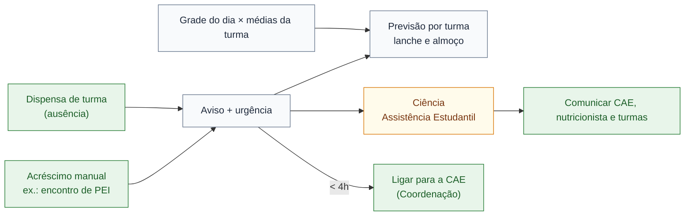

| Etapa | Responsável | Tela | Parte do sistema | Resultado |
| :-- | :-- | :-- | :-- | :-- |
| Previsão | Sistema | Alimentação; agenda da AE na tela inicial | `src/lib/alimentacao/previsao.ts` (`preverRefeicoesDaTurma`), `src/lib/alimentacao/servidor.ts` (`totaisDoDia`) | Lanche só no turno com aula, almoço só em dia integral, já com os avisos |
| Aviso por dispensa | Sistema | — | `recalcularAlertasDaTurma` | Cancelamento com urgência pela antecedência |
| Acréscimo | Coordenação | Alimentação › Acrescentar | `alimentacao/actions.ts` (`criarAcrescimo`), `src/lib/alimentacao/acrescimo.ts` | Refeição extra (contraturno) |
| Ciência | Assistência Estudantil | Alimentação (cartões "Dar ciência" na tela inicial) | `darCiencia` | Aviso confirmado; a Coordenação segue para as mensagens |
| Emergência | Coordenação | Tela inicial (cartão urgente) | `montarAcoes` (`refeicao-emergencia`) | Lembrete de ligar para a CAE (G06) |

---

## 6. Comunicação semiautomática

Toda mensagem nasce pronta no módulo que a originou. A pessoa revisa, envia pelo e-mail institucional ou pelo WhatsApp e registra o envio. O envio automático pela Evolution API existe, mas fica desligado por decisão de projeto.

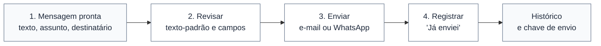

| Etapa | Parte do sistema |
| :-- | :-- |
| Textos de cada módulo | `src/lib/ausencias/mensagens.ts`, `src/lib/alimentacao/mensagens.ts`, `src/lib/calendario/mensagens.ts`, `src/lib/ppe/mensagens.ts`, `src/lib/ppi/mensagens.ts` |
| Textos-padrão editáveis e variáveis | `src/lib/comunicacao/modelos.ts`, Comunicação › Textos-padrão |
| Montagem (saudação do canal, links `mailto:` e `wa.me`) | `src/lib/comunicacao/mensagem.ts`, `src/lib/comunicacao/servidor.ts` |
| Registro do envio | `src/app/(painel)/comunicacao/actions.ts` (`registrarEnvio`) e as ações de envio de PPE e PPI |

A chave de envio evita pedir de novo o que já foi enviado. Na prorrogação da PPE, a chave inclui a data, então uma nova prorrogação pede um novo envio.

---

## 7. PPE e PEI

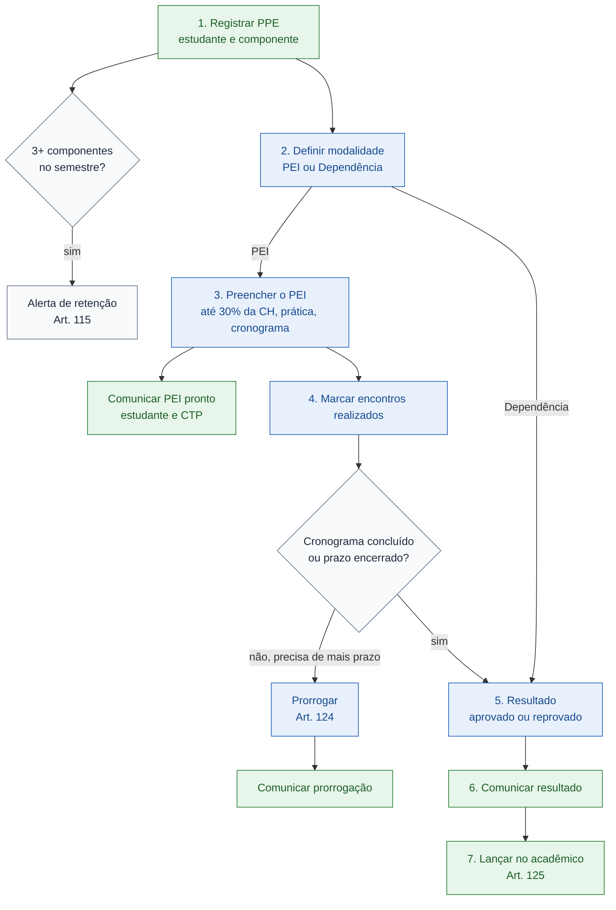

| # | Etapa | Responsável | Tela | Parte do sistema | Resultado |
| :-- | :-- | :-- | :-- | :-- | :-- |
| 1 | Registrar | Coordenação | PPE / PEI › Registrar | `src/app/(painel)/ppe/actions.ts` (`registrarPpe`), `src/lib/ppe/servidor.ts` (`recalcularRetencao`) | PPE aguardando o docente; alerta de retenção |
| 2 | Modalidade | Docente da disciplina | Minhas PPE / PEI (tela inicial: "PPE aguardando você") | `definirModalidade`, `acessoAoPpe` | PPE em andamento |
| 3 | PEI | Docente | PPE › detalhe | `salvarPei`, `src/lib/ppe/regras.ts` (`travasPei`, `lerCronograma`), `clonarCronograma` (G09) | Plano e cronograma; impressão no modelo do campus (`/ppe/[id]/imprimir`) |
| 4 | Encontros | Docente | PPE › Encontros realizados (tela inicial: "Encontros de PEI para confirmar") | `registrarEncontros`, `src/lib/ppe/andamento.ts` (`andamentoDoPei`) | Registro do que foi feito; ao salvar o PEI de novo, as marcas são mantidas (`manterRealizados`) |
| 5 | Resultado | Docente (ou Coordenação) | PPE › Situação (tela inicial: "PEI prontos para lançar o resultado") | `mudarSituacao`, `TRANSICOES` | Aprovado ou reprovado, com nota |
| 6 | Comunicar | Coordenação | PPE › Comunicar | `src/lib/ppe/mensagens.ts`, `src/lib/ppe/comunicar.ts` | Estudante e CTP avisados; a Coordenação é levada direto para cá ao lançar resultado ou prorrogação |
| 7 | Lançamento | Coordenação | PPE / PEI (tela inicial: "PPE com resultado para lançar") | `mudarSituacao` (`exigeCoordenacao`) | Lançado no acadêmico |

A CTP vê todas as PPE, inclusive quando também leciona (`temPermissaoDoCargo`). O docente vê só as das disciplinas que leciona no ano.

---

## 8. PPI (40 horas)

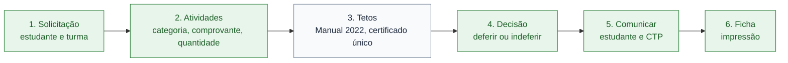

| # | Etapa | Parte do sistema |
| :-- | :-- | :-- |
| 1–2 | Solicitação e atividades | `src/app/(painel)/ppi/actions.ts` (`criarSolicitacao`, `adicionarAtividade`, `alterarAtividade`) |
| 3 | Cálculo das horas | `src/lib/ppi-ppe-engines.ts`, `src/lib/ppi-regras-2022.ts`, `src/lib/ppi/regras.ts` |
| 4–5 | Decisão e mensagens | `decidirSolicitacao`, que leva direto às mensagens; `src/lib/ppi/mensagens.ts` |
| 6 | Ficha | `/ppi/[id]/ficha` |

---

## 9. Diários

> **Em evolução (requisito de 25/11/2026, RF08-A):** como o docente pode não aderir ao sistema, a progressão dos diários
> passará a ser automática: as aulas são presumidas dadas pela grade e pelo calendário, e só as exceções (ausências,
> trocas, dispensas) são registradas. O docente será avisado principalmente por mensagens preparadas pelo sistema. O
> fluxo abaixo descreve o estado atual (lançamento manual); o plano está em `docs/PROXIMOS_PASSOS.md`, seção 4, item 2.

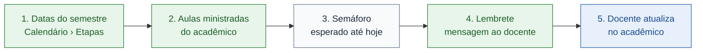

| # | Etapa | Responsável | Parte do sistema |
| :-- | :-- | :-- | :-- |
| 1 | Datas do semestre | Coordenação | `calendario/actions.ts` (etapas e semestres); aviso `semestreSemDatas` na tela inicial |
| 2 | Aulas ministradas | Coordenação | `src/app/(painel)/diarios/actions.ts` (`atualizarDiario`) |
| 3 | Semáforo | Sistema | `src/lib/diarios/regras.ts` (`aulasEsperadas`, `semaforo`) |
| 4 | Lembrete | Coordenação | `registrarLembrete`, `lembreteDoDiario` |
| 5 | Meus diários | Docente | `/diarios?escopo=meus` |

---

## 10. Processos SEI

Quadro com quatro colunas: Novo → Com professor → Aguardando retorno → Concluído. Cada processo tem prazo. O sigilo (Art. 22, VIII) fica restrito à Coordenação.

| Etapa | Responsável | Parte do sistema |
| :-- | :-- | :-- |
| Cadastrar e mover | Coordenação | `src/app/(painel)/processos/actions.ts` |
| Consultar | CTP | `/processos` (sem os sigilosos) |
| Prazos | Sistema | Tela inicial: "Processos com prazo vencido" (atenção) e "Processos que vencem em até 3 dias" (acompanhar) |

---

## 11. Relatórios

Ano letivo → consolidação (sem dados pessoais) → tela, PDF ou planilha. Partes do sistema: `src/lib/relatorios/agregacoes.ts` (funções puras), `src/lib/relatorios/servidor.ts` e `/relatorios/imprimir`. A exportação é feita em `/exportar/relatorios`.

---

## 12. Cargo e docência

Quem tem um cargo (Coordenação, Direção, CTP ou AE) e também leciona vê tudo numa tela só, sem trocar de modo.

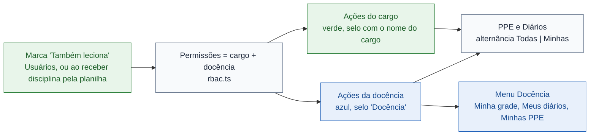

| Parte | Onde |
| :-- | :-- |
| Marca no banco | `User.leciona` (migração `20261125120000_docencia_acumulada`) |
| Regras | `src/lib/auth/rbac.ts`: `ehDocente`, `acumulaDocencia`, `temPermissao` (soma), `temPermissaoDoCargo` (só o cargo) |
| Menus | `src/lib/navegacao.ts` (`funcoesPorGrupo`, `FUNCOES_DOCENCIA`) |
| Cores e selo | `src/components/papel.tsx`; tokens `docencia-*` em `src/app/globals.css` |
| Todas / Minhas | `src/components/escopo.tsx`, usado em `/ppe` e `/diarios` |
| Listas de docentes | `ONDE_DOCENTES` em `src/lib/ofertas/regras.ts` (substitutos, distribuição, grupo de professores, orientadores de PPI) |

---

## 13. Camadas comuns a todos os fluxos

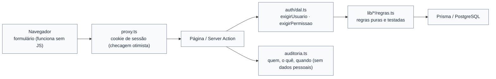

- **Acesso:** toda página e toda ação começam em `exigirUsuario` ou `exigirPermissao`. Esconder um menu não basta.
- **Regras de negócio:** ficam em funções puras (`src/lib/**/regras.ts`, `acoes.ts`, `andamento.ts`, `agenda.ts`), cobertas por testes unitários (Vitest).
- **Fluxos completos:** os testes de ponta a ponta (`e2e/`, Playwright) cobrem os fluxos de uso, com verificação de acessibilidade (axe-core).
- **Auditoria:** `src/lib/auditoria.ts` registra ids e o tipo da ação. Nome e matrícula de estudante ficam de fora.

---

## 14. Análise de gargalos (25/11/2026)

Revisei cada fluxo procurando três coisas:
- **bloqueios:** uma etapa que não tem como ser feita no sistema;
- **gargalos:** quem precisa agir não fica sabendo, ou o trabalho é repetitivo;
- **otimizações:** atalhos entre etapas encadeadas.

### Resolvidos nesta revisão

| Fluxo | Problema encontrado | Tipo | O que mudou |
| :-- | :-- | :-- | :-- |
| PEI | O campo "encontro realizado" existia no banco, mas nenhuma tela permitia marcá-lo. Não havia como acompanhar a execução do cronograma. | Bloqueio | Seção "Encontros realizados" na PPE (`registrarEncontros`). Salvar o PEI de novo mantém as marcas. |
| PEI | O docente não era avisado do fim do cronograma (ou do prazo prorrogado), e o resultado ficava esquecido. | Gargalo | Na tela inicial do docente: "Encontros de PEI para confirmar" e "PEI prontos para lançar o resultado" (`andamentoDoPei`). |
| PPE | O lançamento no acadêmico (Art. 125) dependia de a Coordenação lembrar de abrir cada PPE. | Gargalo | Na tela inicial: "PPE com resultado para lançar no acadêmico". As PPE que aguardam o docente aparecem em "Para acompanhar". |
| PPE | Ao lançar o resultado, a Coordenação precisava voltar à PPE para comunicar. | Otimização | Ao lançar o resultado, a Coordenação vai direto às mensagens do estudante e da CTP, como já acontecia na prorrogação. |
| Ausências | Uma licença de vários dias exigia um registro por dia. | Gargalo | Campo "Até", com período de até 15 dias num só registro, aulas agrupadas por dia e feriados considerados. |
| Preparação do ano | Faltas no cadastro (datas do semestre, disciplinas sem professor, turma sem grade) só apareciam quando algo dava errado depois: diário sem esperado, ausência sem aula, refeição sem previsão. | Gargalo | Cartões na tela inicial da Coordenação: "Datas do semestre", "Disciplinas sem professor" e "Turmas sem grade". |
| Processos | Só os prazos já vencidos apareciam. | Otimização | "Processos que vencem em até 3 dias" em "Para acompanhar". |
| Agenda | A semana do docente sem aulas ocupava cinco caixas iguais. | Otimização | Dia vazio em uma linha só. |
| Ausências | Só a Coordenação registrava: o docente avisava por fora e a Coordenação digitava. | Gargalo | RF02-A (G15): o docente informa a própria ausência em Minha grade; a Coordenação dá ciência (mensagem com a orientação da CGP) e decide a cobertura. |
| Cargo e docência | Quem tinha cargo e também lecionava não via as próprias pendências de docente, e Direção e CTP não podiam lecionar. | Bloqueio | Docência acumulada ao cargo (seção 12). |

### Pendentes de decisão (com sugestão)

| Fluxo | Situação | Sugestão |
| :-- | :-- | :-- |
| Diários | As aulas ministradas são digitadas à mão, disciplina por disciplina, a partir do sistema acadêmico. | Importar por planilha a exportação do acadêmico. Preciso de um arquivo de exemplo, com dados fictícios ou anonimizados, para montar o leitor. |
| Senha | "Esqueci a senha" depende da Coordenação gerar uma nova senha. | Manter assim enquanto não houver envio de e-mail pelo servidor. Com SMTP institucional, oferecer um link de redefinição por e-mail. |
| Convites | O docente convidado só vê o convite ao entrar no sistema. A mensagem individual fica pronta para a Coordenação enviar. | Manter o envio semiautomático (decisão de projeto). Se o envio automático for ligado, o convite individual é o primeiro candidato. |
