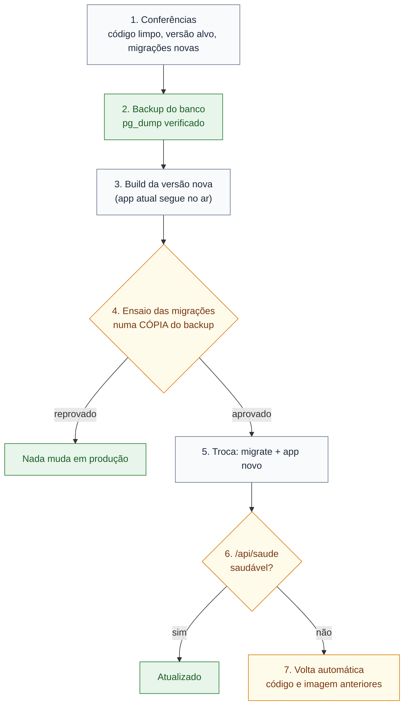

# Implantação em produção

Roteiro para colocar o SGC-Redes no ar numa VM do campus (Proxmox), com Docker Compose, HTTPS e backup diário do
banco. O sistema não depende de serviços externos: o WhatsApp é semiautomático e o e-mail sai do cliente de cada
pessoa (`mailto:`).

> **Pendente:** o endereço definitivo (domínio ou nome na rede do campus). Ele define o `APP_URL` e o certificado.
> Os passos 1 a 4 e 6 podem ser feitos antes; o passo 5 depende do endereço.

---

## 1. VM no Proxmox

| Recurso | Mínimo (testes) | **Produção (recomendado)** | Por quê |
| :--- | :--- | :--- | :--- |
| vCPU | 2 | **4** (tipo de CPU `host`) | Folga para o build da imagem sem deixar o app lento e para picos de acesso |
| RAM | 4 GB | **8 GB** (balão mínimo de 4 GB) | O build usa de 2 a 3 GB; o PostgreSQL usa 1 GB de cache; o app tem limite de 1 GB |
| Disco | 40 GB | **80 GB em SSD** (ou ZFS com SSD) | Imagens Docker (versão atual e anterior), banco, 30 dias de backups locais e logs |
| Sistema | Debian 12 ou Ubuntu Server 24.04 LTS | | |

No `.env` de produção, ajuste o PostgreSQL à VM de 8 GB:

```
PG_SHARED_BUFFERS=1GB
PG_EFFECTIVE_CACHE_SIZE=4GB
PG_WORK_MEM=16MB
PG_MAINTENANCE_WORK_MEM=256MB
```

### 1.1 Dimensionamento para o pico de fim de semestre

**Cenário de projeto.** Até 100 docentes usando o sistema no mesmo período: consultas ao calendário, à grade e às
atividades, além de trocas de horário e de turma.

**O que foi medido** (25/11/2026, build de produção, dados de demonstração). Tempo de processador do app por página,
num Pentium N3700, cerca de 4 vezes mais lento que um núcleo de servidor atual:

| Página | CPU medida | Estimativa num servidor |
| :--- | :---: | :---: |
| Tela inicial da Coordenação (cerca de 25 contagens) | 590 ms | ~150 ms |
| Tela inicial do professor | 290 ms | ~75 ms |
| Calendário | 360 ms | ~90 ms |
| Minha grade | 200 ms | ~50 ms |
| Ausências, Grade, PPE | 120 a 140 ms | ~35 ms |
| `/api/saude` | — | < 5 ms |

Memória do app: cerca de 210 MB em uso.

**Conta do pico.**
- Mesmo pessimista, a conta fica longe do limite: 30 docentes abrem a tela inicial, a grade e o calendário no
  mesmo minuto, logo depois de um aviso no grupo. Isso dá cerca de 6,5 segundos de processador em 60 segundos,
  ou 0,1 núcleo. O último da fila espera cerca de 2 segundos.
- Num uso contínuo de fim de semestre, com 100 docentes trocando de página a cada 20 segundos, a média é de
  5 requisições por segundo, cerca de 0,4 núcleo.
- **2 vCPU dariam conta do uso.** A recomendação de 4 vCPU e 8 GB existe por outros motivos:
  1. **Build na própria VM:** cada atualização constrói a imagem, o que consome 2 vCPU e 3 GB por alguns minutos.
     Com 4 vCPU, o app segue rápido durante o build.
  2. **Um único fio de execução:** o Node processa as páginas num só núcleo, enquanto o banco e o motor do Prisma
     usam os demais. Sobram núcleos para o PostgreSQL atender as consultas em paralelo.
  3. **Folga de memória:** o cache do PostgreSQL mantém o banco inteiro em memória (ele deve ficar abaixo de 1 GB
     por anos).

**Como confirmar em produção.**
- O PostgreSQL registra no log toda consulta acima de 500 ms (`docker compose logs db | grep duration`).
- Para medir de novo, use o mesmo método: `autocannon` com o cookie de uma sessão, contra o endereço interno.
- **Se o pico crescer** (outros cursos, por exemplo), o passo seguinte é rodar **duas réplicas do app** atrás do
  Caddy. Isso usa mais núcleos e permite atualizar sem parar o sistema. Fica registrado em `docs/PROXIMOS_PASSOS.md`.

**Otimização já identificada.** A tela inicial da Coordenação é a mais pesada: cerca de 25 contagens a cada abertura.
Se o log de consultas lentas apontá-la, as contagens podem ser agrupadas ou guardadas em cache por 1 minuto.

- Rede: IP fixo (ou reserva no DHCP) e acesso pela porta 443 a partir da rede do campus. A porta 3000 do app **não**
  deve ficar exposta: só o proxy reverso fala com ela.
- Atualizações automáticas de segurança (`unattended-upgrades`) e fuso `America/Fortaleza`
  (`timedatectl set-timezone America/Fortaleza`).
- No Proxmox, inclua a VM no backup agendado (vzdump). Ele complementa o backup do banco do passo 6, mas não o
  substitui: com o `pg_dump` dá para restaurar só o banco, em qualquer máquina.

## 2. Docker e código

```bash
# Docker Engine + plugin compose (repositório oficial): https://docs.docker.com/engine/install/
sudo apt install -y git
sudo git clone https://github.com/cctrc-bvg/sgc-redes-bvg.git /opt/sgc-redes
sudo chown -R "$USER" /opt/sgc-redes
cd /opt/sgc-redes
```

## 3. Configuração (`.env`)

```bash
cp .env.example .env
chmod 600 .env
```

Preencha:

| Variável | Valor |
| :--- | :--- |
| `POSTGRES_USER`, `POSTGRES_DB` | nomes à escolha (ex.: `sgc_redes`, `sgc_redes_ifce`) |
| `POSTGRES_PASSWORD` | senha longa e aleatória: `openssl rand -base64 32` |
| `APP_URL` | endereço **https** definitivo (ex.: `https://sgc-redes.exemplo.ifce.edu.br`) — sem barra no final |
| `SEED_COORDENADOR_EMAIL` | e-mail institucional da Coordenação |
| `SEED_COORDENADOR_SENHA` | deixe **vazio**: o seed gera uma senha e mostra uma única vez no log do `migrate` |
| `WHATSAPP_WEBHOOK_*` | vazio (envio automático desligado, decisão de 24/11/2026) |

Com `APP_URL` em `https://`, o cookie de sessão sai marcado como `Secure`: **o login só funciona pelo endereço https**.
`DATABASE_URL` do `.env` não é usada pelo Compose (ele monta a URL a partir das variáveis do banco).

**Nunca** rode `npm run db:demo` em produção: ele cria usuários com senha conhecida (o script se recusa com
`NODE_ENV=production`, mas não conte com isso).

## 4. Subir a stack

```bash
docker compose up --build -d
docker compose logs migrate       # migrações + seed; anote a senha provisória da Coordenação, se gerada
docker compose ps                 # db (healthy), migrate (exited 0), app (up)
```

A cada atualização do código, use o script de atualização segura (seção 8):

```bash
./scripts/atualizar.sh            # backup, build, ensaio das migrações, troca e verificação de saúde
```

## 5. HTTPS com proxy reverso

O app escuta em `127.0.0.1:3000`. O Compose já publica a porta só para o próprio host (`APP_PORTA`), então apenas
o proxy reverso fala com ela.

**Opção A — Caddy (mais simples).** Obtém e renova o certificado sozinho quando o nome é público (Let's Encrypt). Para
um nome só da rede interna, use o certificado emitido pela TI (`tls /caminho/cert.pem /caminho/chave.pem`).

```bash
sudo apt install -y caddy
```

`/etc/caddy/Caddyfile`:

```
sgc-redes.exemplo.ifce.edu.br {
	encode zstd gzip
	reverse_proxy 127.0.0.1:3000
	header Strict-Transport-Security "max-age=31536000"
}
```

O próprio app já envia a política de conteúdo (CSP), `X-Frame-Options`, `X-Content-Type-Options`,
`Referrer-Policy` e `Permissions-Policy` (`next.config.ts`). O proxy só acrescenta o HSTS, que depende do HTTPS.

```bash
sudo systemctl reload caddy
```

**Opção B — Nginx** com o certificado da TI (ou `certbot --nginx`): `proxy_pass http://127.0.0.1:3000;` com
`proxy_set_header Host $host;`, `proxy_set_header X-Forwarded-For $remote_addr;` (sobrescreve o que o cliente enviar; o app usa o último valor da lista como IP de origem, no limite de tentativas de login e na auditoria; com mais de um proxy, defina `PROXY_SALTOS` no `.env`) e
`proxy_set_header X-Forwarded-Proto https;`, `client_max_body_size 7m;` (importação de planilhas, até 1 MB, e formulários de reposição, até 5 MB) e
`add_header Strict-Transport-Security "max-age=31536000" always;`.

Depois do proxy: confira que `APP_URL` no `.env` é exatamente o endereço https e rode `docker compose up -d app` para
o app ler o valor novo. Os links das mensagens prontas ("Minha grade", ausências) usam esse endereço.

## 6. Backup diário do banco

`scripts/backup-banco.sh` roda `pg_dump` dentro do contêiner, confere que o arquivo é legível, grava em
`BACKUP_DIR` (padrão `./backups`, só o dono acessa) e apaga os mais antigos que `RETENCAO_DIAS` (padrão 30).

```bash
sudo mkdir -p /srv/backups/sgc && sudo chown "$USER" /srv/backups/sgc
BACKUP_DIR=/srv/backups/sgc ./scripts/backup-banco.sh       # teste manual
```

Agendamento com cron (todo dia às 02:30), em `crontab -e` do usuário que roda o Docker:

```
30 2 * * * BACKUP_DIR=/srv/backups/sgc RETENCAO_DIAS=30 /opt/sgc-redes/scripts/backup-banco.sh >> /srv/backups/sgc/backup.log 2>&1
```

**Cópia fora da VM:** o backup local não protege contra a perda da VM. Copie `/srv/backups/sgc` para outro servidor ou
storage do campus (ex.: `rsync` agendado, ou um compartilhamento montado como `BACKUP_DIR`). Os arquivos têm dados
pessoais (LGPD): destino com acesso restrito à Coordenação e à TI.

**Teste de restauração** (faça uma vez na implantação e depois a cada semestre), numa VM de teste ou com o app parado:

```bash
docker compose stop app
./scripts/backup-banco.sh --restaurar /srv/backups/sgc/sgc-AAAA-MM-DD_HHMMSS.dump
docker compose start app
```

**Frequência no fim de semestre:** acrescente backups ao longo do dia, por exemplo às 12:30 e às 18:30. O RPO, que é
a perda máxima de dados se a VM se perder, cai de 24 para cerca de 6 horas. O custo é baixo, pois o banco é pequeno.

```
30 2,12,18 * * * BACKUP_DIR=/srv/backups/sgc RETENCAO_DIAS=30 /opt/sgc-redes/scripts/backup-banco.sh >> /srv/backups/sgc/backup.log 2>&1
```

## 7. Depois de subir

- [ ] Entrar com o e-mail da Coordenação, trocar a senha provisória.
- [ ] **Comunicação → Grupos e setores:** e-mail institucional e saudação de cada grupo (CAE, nutricionista, CTP,
      Gestão, líderes de turma).
- [ ] Cadastrar (ou importar por planilha) usuários, turmas, disciplinas, ofertas, grade e calendário do ano.
- [ ] Conferir um backup gerado pelo cron no dia seguinte e a cópia fora da VM.
- [ ] Registrar o endereço, a localização dos backups e quem tem acesso no documento da TI.

## Problemas comuns

| Sintoma | Causa provável |
| :--- | :--- |
| Login volta para a tela de login sem erro | Acesso por `http://` ou por outro endereço com `APP_URL` em https (cookie `Secure`). |
| `migrate` termina com erro | Veja `docker compose logs migrate`; banco sem espaço ou senha do `.env` diferente da do volume já criado. |
| Importação de planilha falha no proxy | Limite de upload do proxy abaixo de 7 MB (`client_max_body_size`). |
| Horários um dia antes/depois | Fuso da VM; o app usa `America/Fortaleza` nas regras, mas os logs e o cron usam o fuso da VM. |

---

## 8. Atualizações sem perda de dados

O sistema vai receber telas, fluxos e processos novos depois de entrar em produção. Cada atualização segue o
mesmo roteiro, automatizado em `scripts/atualizar.sh`. Programe a atualização fora do horário letivo, com aviso
prévio no grupo de professores. O app fica fora do ar só durante a troca de contêiner, alguns segundos.



```bash
./scripts/atualizar.sh               # para a versão mais recente (origin/main)
./scripts/atualizar.sh v1.3.0        # para uma versão marcada (tag)
./scripts/atualizar.sh --voltar      # volta à versão anterior a qualquer momento
./scripts/ensaiar-migracao.sh        # só o ensaio, sobre o backup mais recente
```

### 8.1 Por que os dados não se perdem

1. **Backup antes de tudo.**
   - O script para se o backup falhar.
   - O backup é conferido (`pg_restore --list`) antes de ser aceito.
2. **Ensaio sobre uma cópia.**
   - As migrações novas rodam antes num PostgreSQL temporário e isolado, restaurado do backup recém-feito.
   - Se falharem ali (tipo incompatível, coluna obrigatória sem valor, dado inesperado), a produção nem é tocada.
3. **Migrações só acrescentam.** A política "expandir → migrar dados → contrair":
   - **Expandir:** a versão N só acrescenta tabelas, colunas anuláveis ou com valor padrão e índices. A versão
     anterior do app continua funcionando sobre o banco já migrado, e é isso que permite a volta automática.
   - **Migrar dados:** o código novo passa a usar o que foi acrescentado e, se preciso, copia os dados antigos.
   - **Contrair:** numa versão seguinte, só depois de confirmar que nada mais usa o campo velho, a migração remove
     o que sobrou. Ela precisa da linha `-- sgc:destrutiva-aprovada: <motivo>`, e o script pede confirmação.
4. **Barreira no código.**
   - O teste `src/lib/implantacao/migracoes.test.ts`, que roda no CI, reprova a migração nova que apague, renomeie,
     mude o tipo ou torne obrigatória uma coluna sem a marca de aprovação.
   - Ele também reprova coluna nova obrigatória sem valor padrão, que falharia numa tabela com dados.
5. **Volta atrás.**
   - O script guarda as imagens anteriores (`:anterior`) e o commit anterior.
   - Se o app novo não ficar saudável em 3 minutos, volta sozinho. `--voltar` faz o mesmo à mão.
   - Só uma contração aprovada exige restaurar o backup para voltar, e por isso o script avisa antes.

### 8.2 Mudança grande de esquema (exemplo)

Exemplo: trocar `motivoOperacional` (texto) por uma tabela de motivos.

| Versão | Migração | Código |
| :--- | :--- | :--- |
| 1.4 | cria a tabela `MotivoAusencia` e a coluna `motivoId` anulável; copia os textos existentes para a tabela | grava nos dois campos e lê do novo |
| 1.5 | (nenhuma) | lê e grava só o novo |
| 1.6 | `-- sgc:destrutiva-aprovada: remove motivoOperacional, sem uso desde a 1.5; ensaio em AAAA-MM-DD` + `DROP COLUMN` | — |

Entre uma versão e outra, a volta é automática e não há dado perdido.

### 8.3 Para quem desenvolve

- Gere a migração com `npx prisma migrate dev --create-only` e **leia o SQL antes de aplicar**. O Prisma às vezes
  gera `DROP`/`ADD` onde se queria `RENAME`, ou coluna `NOT NULL` sem padrão.
- Teste a migração sobre os dados de demonstração (`npm run db:demo`) e rode `npm test`, que inclui a política.
- Nunca edite uma migração já aplicada em produção. Crie outra.

## 9. Disponibilidade e monitoramento

| Camada | Como está | Recomendação |
| :--- | :--- | :--- |
| App | `restart: unless-stopped`, healthcheck em `/api/saude` a cada 30 s, limite de memória de 1 GB | Monitorar `https://<endereço>/api/saude` no Zabbix ou Uptime Kuma da TI, com alerta por e-mail à Coordenação e à TI |
| Banco | healthcheck `pg_isready`, volume próprio, log de consultas lentas | Backups ao longo do dia no fim de semestre (seção 6) e cópia fora da VM |
| VM | backup vzdump | Se o cluster Proxmox tiver armazenamento compartilhado, ative o **HA** para a VM: ela reinicia em outro nó se o host cair |
| Atualização | `scripts/atualizar.sh` com ensaio e volta automática | Atualizar fora do horário letivo; nunca no fim de semestre sem necessidade |
| Restauração | `backup-banco.sh --restaurar` | Ensaiar a restauração a cada semestre (seção 6); meta de RTO, o tempo para voltar ao ar, de até 1 hora |
