# SGC-Redes — Manual do usuário

> Gerado de `src/lib/ajuda/topicos.ts` por `npm run manual` — não edite à mão. O mesmo conteúdo está no sistema, em **Ajuda**
> (com versão para imprimir/PDF em `/ajuda/manual`). As telas usam dados fictícios de demonstração.

O SGC-Redes apoia a rotina da Coordenação do Curso Técnico Integrado em Redes de Computadores do IFCE Campus Boa Viagem:
calendário, grade, ausências e substituições, refeições, comunicação por e-mail ou WhatsApp, PPE/PEI, PPI, diários,
processos e relatórios. Ele complementa os sistemas oficiais (SUAP/Q-Acadêmico, SEI), sem substituí-los.

## Sumário

1. [Primeiros passos](#1-primeiros-passos)
2. [Calendário acadêmico](#2-calendário-acadêmico)
3. [Grade horária](#3-grade-horária)
4. [Ausências e substituições](#4-ausências-e-substituições)
5. [Alimentação](#5-alimentação)
6. [Comunicação](#6-comunicação)
7. [PPE / PEI](#7-ppe--pei)
8. [PPI (40 horas)](#8-ppi-40-horas)
9. [Diários](#9-diários)
10. [Processos SEI](#10-processos-sei)
11. [Relatórios](#11-relatórios)
12. [Cadastros: usuários, turmas, disciplinas e ofertas](#12-cadastros-usuários-turmas-disciplinas-e-ofertas)
13. [Planilhas, impressão e PDF](#13-planilhas-impressão-e-pdf)
14. [Privacidade, segurança e auditoria](#14-privacidade-segurança-e-auditoria)
15. [Quem vê o quê](#15-quem-vê-o-quê)

## 1. Primeiros passos

Acesso, troca de senha, tela inicial, menus e preferências de contato.

No sistema: `/painel` · disponível para todos os perfis.

### O que você pode fazer

- Entrar com o e-mail institucional e a senha recebida da Coordenação.
- Trocar a senha provisória no primeiro acesso (obrigatório).
- Na tela inicial, ver primeiro o que precisa da sua atenção agora (do mais urgente ao menos), com um botão para resolver cada item.
- Abrir "Todas as funções" com um clique: cada função tem um ícone, o mesmo do menu do cabeçalho. Sem pendências, o menu já vem aberto.
- Acompanhar a agenda: o professor vê a própria semana (aulas, feriados, substituições); a Assistência Estudantil, as refeições previstas para hoje e amanhã; os demais perfis, o mês do calendário acadêmico e os próximos eventos (a Coordenação, também as ausências de hoje).
- Se você tem um cargo (Coordenação, Direção, CTP) e também leciona, ver tudo junto: o que é do cargo em verde e o que é da docência em azul, sempre com o nome "Docência" escrito.
- Voltar à tela inicial de qualquer página pelo botão "Início" do cabeçalho.
- Informar seu WhatsApp e dizer se aceita recebê-lo pelo sistema (Meu contato).
- Sair do sistema em qualquer página (botão Sair). A sessão expira após 8 horas sem uso.

### Fluxo: Primeiro acesso

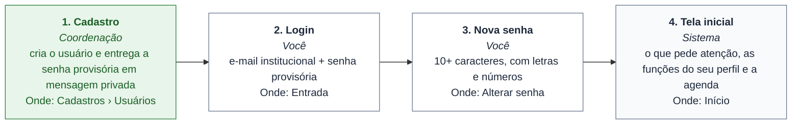

*Cores: verde, Coordenação e gestão; azul, docência; âmbar, setores; cinza, o próprio sistema.*

### Passo a passo

**Entrar pela primeira vez** (Todos)

1. Abra o endereço do sistema e informe seu e-mail institucional e a senha provisória.
2. O sistema pede uma nova senha: use pelo menos 10 caracteres, com letras e números, diferente da provisória.
3. Pronto: a tela inicial mostra o que precisa da sua atenção, as funções do seu perfil e a sua agenda.

**Ajustar preferências de contato** (Todos)

1. No cabeçalho, clique no seu nome e escolha "Meu contato".
2. Informe o WhatsApp (a máscara preenche o formato) e marque se aceita que o sistema use esse número.
3. Sem WhatsApp, todas as mensagens continuam disponíveis para envio pelo e-mail institucional.

**Tenho um cargo e também dou aula** (Coordenação, Direção, CTP ou AE que lecionam)

1. Peça à Coordenação para marcar "Também leciona" no seu cadastro (em Usuários). Ao receber uma disciplina pela planilha de ofertas, a marca liga sozinha.
2. Na tela inicial, os cartões trazem o selo do papel: "Docência" (azul) para convites de substituição, PPE e diários seus; o nome do cargo (verde) para o resto.
3. No cabeçalho, o menu "Docência" reúne Minha grade, Meus diários e Minhas PPE / PEI.
4. Em PPE e Diários, alterne entre "Todas" (o que o cargo acompanha) e "Minhas" (as suas disciplinas).
5. Na agenda, "Minha semana" mostra as suas aulas; o calendário do mês fica recolhido logo abaixo.

**Esqueci a senha** (Todos)

1. Peça à Coordenação: em Usuários, ela gera uma nova senha provisória para você.
2. No próximo acesso, o sistema pede a troca da senha.

### Telas

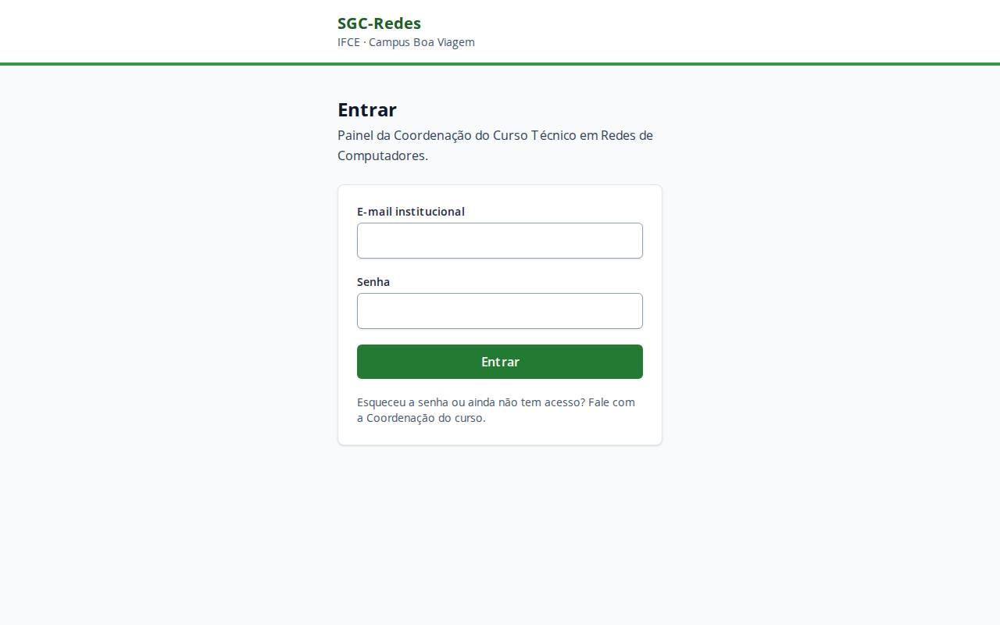

*Tela de entrada: e-mail institucional e senha.*

*Tela inicial da Coordenação que também leciona: o cargo em verde, a docência em azul.*

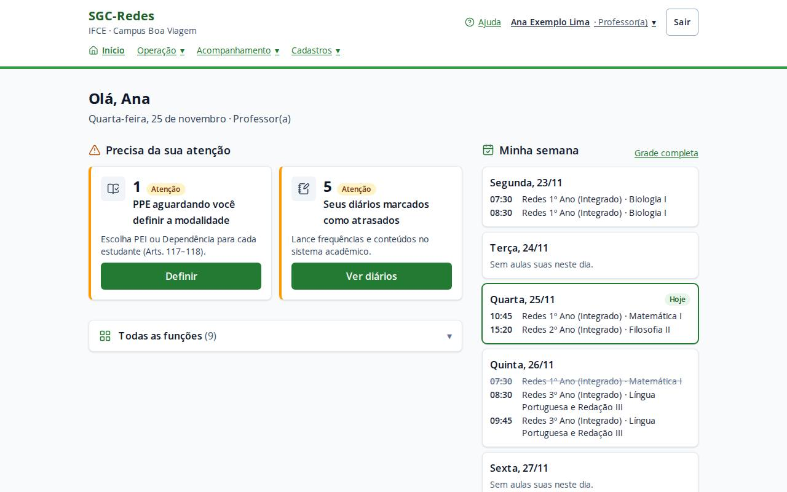

*O professor vê a própria semana; cada perfil vê só as suas funções.*

### Dúvidas frequentes

- **Errei a senha várias vezes e fui bloqueado. E agora?** Depois de 5 tentativas erradas, o login daquele e-mail fica bloqueado por 15 minutos. Espere ou peça uma nova senha à Coordenação.
- **Um menu que eu esperava não aparece.** Os menus dependem do perfil (veja "Quem vê o quê" no início da Ajuda). Se precisar de outro acesso, fale com a Coordenação.
- **Por que algumas ações aparecem em azul?** Para quem tem um cargo e também leciona, azul (com o selo "Docência") marca o que é da sua docência; verde, o que é do cargo. Quem tem um papel só não vê essa distinção.
- **Onde ficaram as outras funções na tela inicial?** Em "Todas as funções", logo abaixo das pendências: clique para abrir. Elas também estão nos menus do cabeçalho.
- **Preciso usar meu WhatsApp pessoal?** Não. Todas as comunicações funcionam pelo e-mail institucional; o WhatsApp é opcional.

## 2. Calendário acadêmico

Dias letivos, etapas N1–N4, sábados letivos, feriados, eventos e alterações imprevistas.

No sistema: `/calendario`.

### O que você pode fazer

- Cadastrar as datas das etapas N1 a N4 e dos semestres de cada ano letivo.
- Cadastrar eventos: férias docentes, matrícula, encontro pedagógico, acolhida, feriados, pontos facultativos, PITs/RITs, reuniões, avaliações finais e outros.
- Registrar suspensões não previstas (falta de energia, de água, de transporte, luto oficial, ponto facultativo municipal…) como dias a repor.
- Cadastrar sábados letivos, cada um seguindo a grade de um dia da semana.
- Contar os dias letivos por mês, etapa, semestre e ano, comparando com a meta (50 por etapa, 200 no ano).
- Avaliações finais nunca contam como dias letivos (ROD, Art. 32; refeições nesses dias só por acréscimo lançado na Alimentação): ficam fora da contagem e da grade, inclusive aos sábados. Acontecem só no fim do ano, depois da última semana letiva, também para as disciplinas semestrais; o sistema avisa se o período for cadastrado antes disso e, enquanto elas não estiverem cadastradas, sugere começar no dia seguinte ao último dia letivo. Os prazos entre as avaliações são combinados com os docentes.
- Ver o ano inteiro ou um mês, imprimir/salvar em PDF e exportar/importar em planilha.
- Ao registrar uma alteração imprevista, abrir as mensagens prontas para avisar docentes, CAE, nutricionista, Gestão, CTP e turmas.

### Fluxo: Montar o calendário do ano

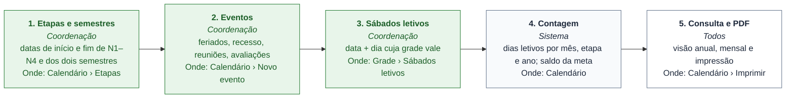

*Cores: verde, Coordenação e gestão; azul, docência; âmbar, setores; cinza, o próprio sistema.*

### Passo a passo

**Cadastrar as etapas do ano** (Coordenação)

1. Abra Calendário e escolha o ano (setas ← →).
2. Clique em "Etapas e semestres" e informe início e término de N1 a N4 (e dos dois semestres, usados pelos diários).
3. Salve. O resumo passa a mostrar os dias letivos de cada etapa e o saldo em relação à meta.

**Cadastrar um feriado ou evento** (Coordenação)

1. Clique em "Novo evento" (ou no número do dia, na visão do mês).
2. Escolha o tipo, as datas (término vazio = um dia) e a descrição.
3. Marque "Sem aula" se o dia sai da contagem de dias letivos (já vem marcado para feriado, férias etc.).
4. Salve: o evento aparece colorido no calendário e entra na contagem.

**Registrar uma suspensão não prevista (força maior)** (Coordenação)

1. Em "Novo evento", escolha "Suspensão de aulas (força maior)" e o motivo (falta de energia, de água, de transporte, luto…).
2. Marque "Imprevisto": o dia entra como dia letivo perdido, a repor.
3. Ao salvar, o sistema abre as mensagens prontas para CAE, nutricionista, todos os docentes, Gestão, CTP e líderes de turma. Envie e registre cada uma.
4. Cadastre o sábado letivo de reposição em Grade › Sábados letivos.

**Copiar o calendário para o ano seguinte** (Coordenação)

1. No calendário do ano atual, clique em "Exportar planilha (.xlsx)".
2. No Excel ou LibreOffice, troque as datas para o novo ano.
3. Em "Importar planilha", escolha o novo ano, envie o arquivo, confira a prévia e confirme.

### Telas

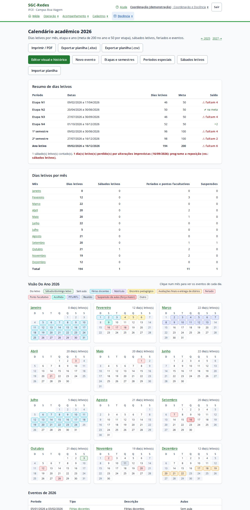

*Visão anual: resumo da contagem e os 12 meses, com cores por tipo de evento.*

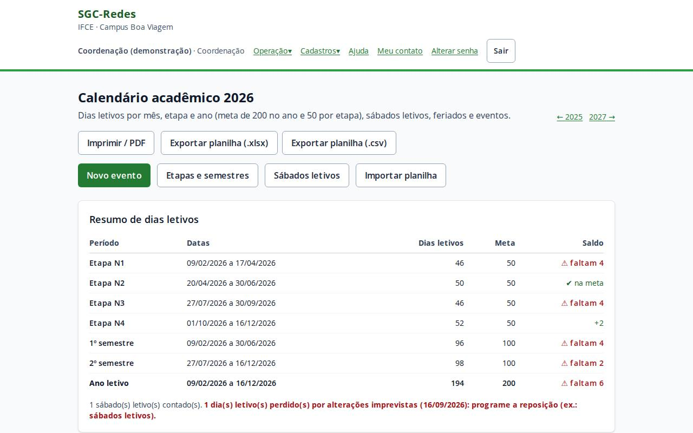

*Visão do mês: clique no dia para cadastrar um evento ou no evento para editá-lo.*

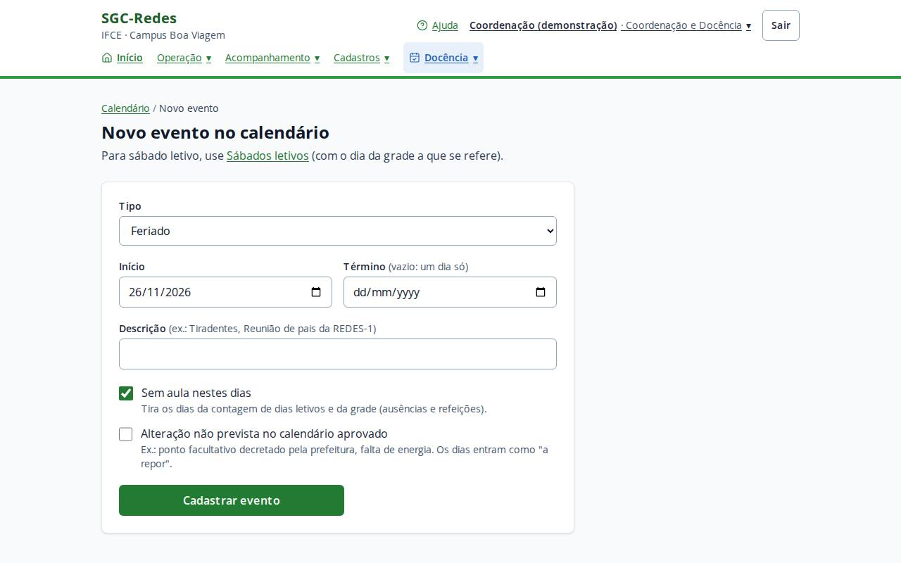

*Cadastro de evento: tipo, datas, "Sem aula" e "Imprevisto".*

### Dúvidas frequentes

- **Por que o total do ano não bate com a soma dos meses de julho?** Dias fora das etapas (recesso entre N2 e N3, por exemplo) não contam como letivos, mesmo sendo dias úteis.
- **Um feriado caiu num sábado letivo. O que acontece?** Evento com "Sem aula" vale também para o sábado letivo: o dia sai da contagem.
- **A suspensão afeta outras telas?** Sim. Em dia sem aula pelo calendário, Ausências e Alimentação não mostram aulas nem refeições daquele dia.

## 3. Grade horária

Horários das turmas, grade individual do professor, janelas livres, sábados letivos e importação.

No sistema: `/grade`.

### O que você pode fazer

- Consultar a grade de cada turma por ano e semestre, com disciplina e professor em cada horário.
- Ver a sua grade individual (Minha grade) e responder convites de substituição.
- Informar a sua ausência à Coordenação (um dia ou um período de até 15 dias) e acompanhar a situação em "Minhas ausências" (docentes).
- Identificar janelas livres: horários vagos num turno em que a turma tem aula.
- Conferir se as aulas na grade batem com a carga horária da matriz.
- Editar a grade com verificação de choque de horário do professor entre turmas (Coordenação).
- Copiar as disciplinas anuais do 1º para o 2º semestre.
- Importar e exportar a grade em planilha; imprimir/salvar em PDF a grade de uma turma ou de todas.

### Fluxo: Montar a grade do semestre

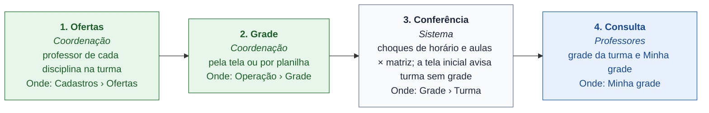

*Cores: verde, Coordenação e gestão; azul, docência; âmbar, setores; cinza, o próprio sistema.*

### Passo a passo

**Montar a grade pela tela** (Coordenação)

1. Em Grade, escolha ano e semestre e clique em "Ver grade" da turma; depois em "Editar grade".
2. Em cada horário, escolha a disciplina (aparecem as anuais e as técnicas do semestre).
3. Salve. Se o professor já tiver aula em outra turma naquele horário, o sistema recusa e marca a célula.

**Montar a grade por planilha** (Coordenação)

1. Em Grade, clique em "Importar planilha" e baixe o modelo: ele traz a grade atual ou, para turma sem grade, uma linha por aula semanal prevista de cada disciplina.
2. Preencha Dia e Início (ou Turno e Bloco A–D) de cada aula.
3. Escolha o modo: "Completar" muda só as linhas enviadas; "Substituir" deixa as turmas da planilha exatamente como nela.
4. Envie, confira a prévia (erros por linha) e confirme.

**Consultar a minha grade e responder convites** (Professor)

1. Em Grade, clique em "Ver minha grade": aparecem suas aulas em todas as turmas e os sábados letivos.
2. Se houver convite de substituição, ele aparece no topo: aceite ou recuse.

**Informar minha ausência** (Professor)

1. Em Minha grade, clique em "Informar ausência" (ou use o menu).
2. Escolha a data; para vários dias, preencha também "Até" (até 15 dias). Aparecem as suas aulas pela grade.
3. Marque as aulas e escolha um motivo operacional da lista. Nunca escreva o motivo pessoal ou médico.
4. Envie: a Coordenação recebe o aviso na tela inicial, dá ciência e organiza a cobertura. Se a ausência for hoje, ligue também para a Coordenação.
5. Acompanhe em "Minhas ausências"; enquanto a Coordenação não decidir, você pode cancelar.
6. O motivo e o comprovante (ex.: atestado médico) vão direto à Coordenadoria de Gestão de Pessoas (CGP), pelo e-mail cgp.boaviagem@ifce.edu.br, fora do sistema.

### Telas

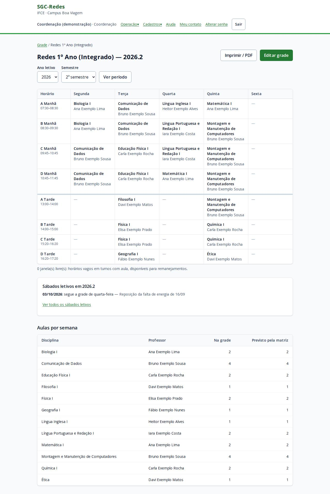

*Grade da turma, com janelas livres destacadas e a conferência com a matriz.*

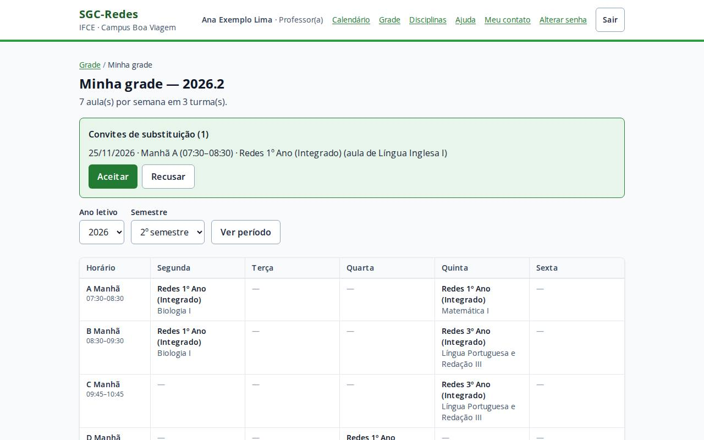

*Minha grade (professor): aulas em todas as turmas e convites de substituição.*

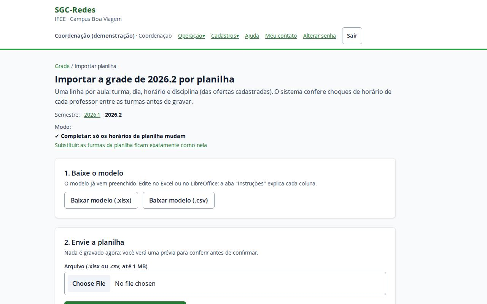

*Importação da grade por planilha.*

### Dúvidas frequentes

- **Uma disciplina não aparece para escolher na grade.** Ela precisa estar distribuída em Ofertas para a turma e o ano, e valer no semestre (técnicas são de um semestre só).
- **Como funciona o sábado letivo na grade?** Cada sábado letivo segue a grade de um dia da semana (ex.: "grade de quarta"), cadastrado em Grade › Sábados letivos.

## 4. Ausências e substituições

Registro de falta docente, decisão de cobertura de cada horário, convites, refeições e mensagens.

No sistema: `/ausencias`.

### O que você pode fazer

- Registrar a ausência de um docente numa data: o sistema mostra as aulas dele pela grade vigente.
- Licença de vários dias: informe também "Até" (até 15 dias) e registre todas as aulas do período de uma vez; feriados e sábados letivos já entram na conta.
- Acompanhar o prazo de reposição das aulas dispensadas (15 dias letivos ou o fim da etapa, o que vier primeiro, ROD Art. 37): aparece na ausência e, quando está vencido ou perto de vencer sem data agendada, na tela inicial.
- Receber as ausências que os próprios docentes informam (selo "Informada pelo docente" e contagem na tela inicial) e dar ciência a eles.
- Para cada horário perdido: substituição por outro docente, adiantamento de uma aula posterior da turma, dispensa da turma ou decidir depois.
- Sugestões de cobertura priorizando professores da mesma turma e livres no horário.
- Convidar docentes para substituir; eles aceitam ou recusam em Minha grade.
- Calcular o impacto nas refeições da turma (lanches e almoço) e avisar a Assistência Estudantil com a urgência (24h, imprevisto, emergência).
- Gerar as mensagens prontas para docentes, CTP, Gestão, CAE, nutricionista e líderes de turma.

### Fluxo: Da ausência à comunicação

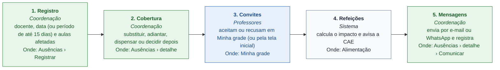

*Cores: verde, Coordenação e gestão; azul, docência; âmbar, setores; cinza, o próprio sistema.*

### Passo a passo

**Registrar uma ausência** (Coordenação)

1. Em Ausências, clique em "Registrar ausência".
2. Escolha o docente e a data: aparecem as aulas dele naquele dia. Para vários dias, preencha também "Até": as aulas aparecem separadas por dia.
3. Marque as aulas afetadas e informe um motivo operacional, sem dados pessoais ou médicos (ex.: "Participação em evento").
4. Em Comunicar, envie ao docente a "Ciência da sua ausência": ela já orienta a procurar a Gestão de Pessoas com o motivo e o comprovante, fora do sistema.
5. Salve: a página da ausência abre com a situação de cada horário.

**Decidir a cobertura** (Coordenação)

1. Em "Decidir a cobertura", escolha para cada horário: substituto sugerido, adiantamento de aula, dispensa ou decidir depois.
2. Opcional: em "Convites de substituição", convide um ou mais docentes; quem aceitar primeiro assume o horário.
3. Confira "Refeições da turma neste dia": dispensas podem cancelar lanche ou almoço, com aviso à CAE.
4. Em "Mensagens prontas", copie cada texto para o e-mail ou WhatsApp e clique em "Já enviei: registrar".

### Telas

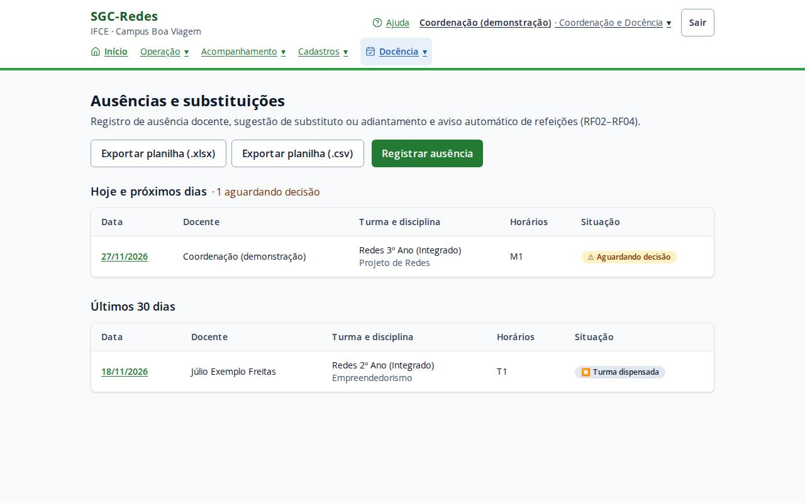

*Lista de ausências e a situação de cada uma.*

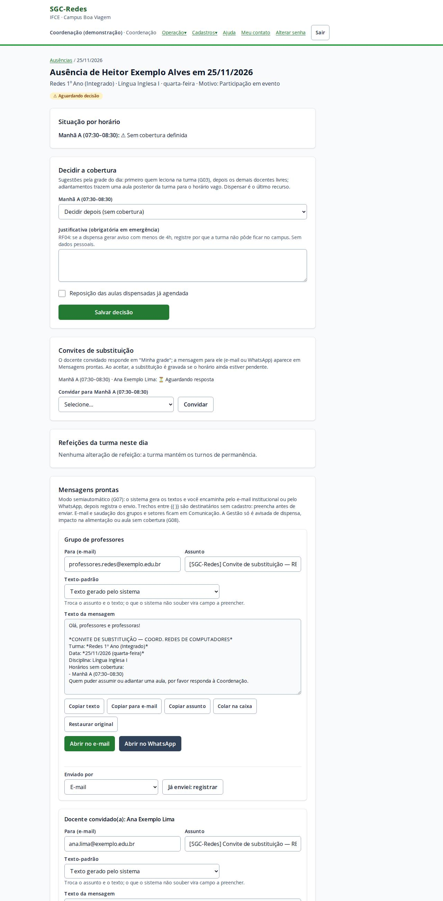

*Página da ausência: cobertura, convites, refeições e mensagens prontas.*

### Dúvidas frequentes

- **Posso registrar uma ausência que já aconteceu?** Sim, até 30 dias para trás, e ausências planejadas até um ano à frente.
- **O docente avisou que não vai mais faltar.** Na página da ausência, use "Cancelar registro". Os avisos de refeição são desfeitos e a CAE vê que tudo volta ao normal.
- **Por que não posso escrever o motivo real da falta?** Por privacidade (LGPD): o sistema e as mensagens trazem só um motivo operacional. Atestados e motivos pessoais ficam nos sistemas oficiais.
- **E o atestado ou o motivo da ausência do docente?** O docente trata direto com a Coordenadoria de Gestão de Pessoas (CGP, cgp.boaviagem@ifce.edu.br): informa o motivo e entrega o comprovante (por exemplo, atestado médico). Isso não passa pelo SGC-Redes nem pela Coordenação do curso; a mensagem de ciência da ausência traz essa orientação.
- **O que é o selo "Informada pelo docente"?** O próprio docente informou a ausência em Minha grade. Dê ciência a ele pela mensagem pronta e decida a cobertura, como num registro feito pela Coordenação.

## 5. Alimentação

Avisos de refeição por turma (lanches e almoço), urgência, ciência da CAE e comunicação.

No sistema: `/alimentacao`.

### O que você pode fazer

- Ver, por data, os avisos de cancelamento ou acréscimo de lanche da manhã (09:30), almoço (12:00) e lanche da tarde (15:00).
- Classificar a urgência pela antecedência: 🟢 24h ou mais, 🟡 imprevisto (4h a 24h), 🔴 emergência (menos de 4h).
- Lançar acréscimos (ex.: encontro de PEI no contraturno) e ajustar quantidades (Coordenação).
- Dar ciência dos avisos (Assistência Estudantil).
- Depois de ciência, ajuste ou acréscimo, abrir as mensagens prontas para CAE, nutricionista, Gestão e líderes de turma.
- Respeitar o calendário: em dia sem aula, não há refeições previstas.

### Fluxo: Aviso de refeição

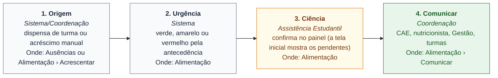

*Cores: verde, Coordenação e gestão; azul, docência; âmbar, setores; cinza, o próprio sistema.*

### Passo a passo

**Acrescentar uma refeição** (Coordenação)

1. Em Alimentação, clique em "Acrescentar refeição".
2. Escolha turma, data, refeição, quantidade e o motivo (sem dados de estudantes).
3. Salve: o aviso vai para o painel da Assistência Estudantil e o sistema abre as mensagens prontas.

**Dar ciência** (Assistência Estudantil)

1. Em Alimentação, confira os avisos pendentes do dia.
2. Clique em "Dar ciência" em cada aviso. A Coordenação vê a confirmação.

### Telas

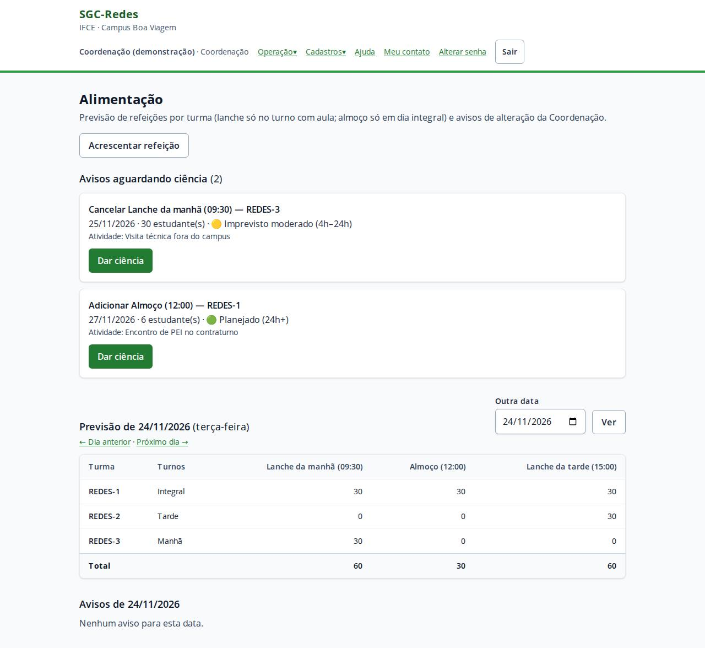

*Avisos de refeição do dia, com urgência e ciência da CAE.*

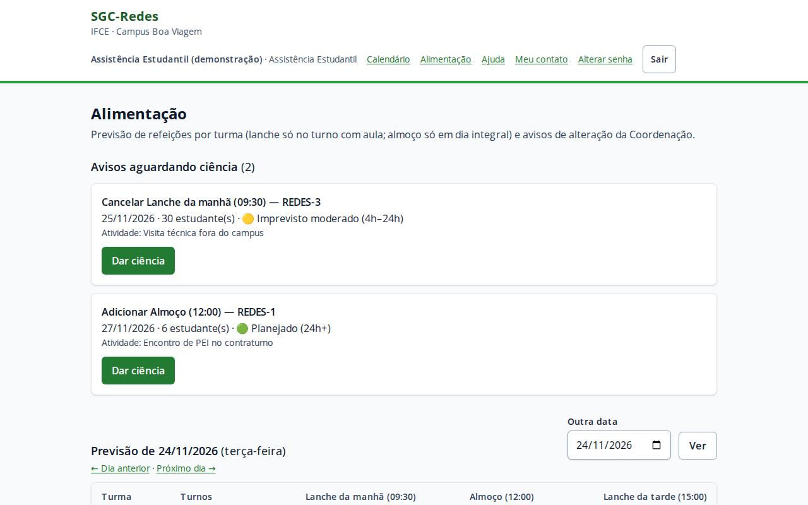

*Visão da Assistência Estudantil: só refeições, sem dados pessoais.*

### Dúvidas frequentes

- **A turma foi dispensada depois do almoço já servido.** Refeições cujo horário já passou não geram aviso; só as futuras afetadas.
- **O almoço é sempre previsto?** Não. Os estudantes só almoçam no campus nos dias em que têm aula nos dois turnos (regime integral).

## 6. Comunicação

Mensagens prontas por e-mail ou WhatsApp, mensagem avulsa, textos-padrão, grupos e histórico.

No sistema: `/comunicacao`.

### O que você pode fazer

- Modo semiautomático: o sistema escreve a mensagem e você envia pelo e-mail institucional ou pelo WhatsApp, e registra o envio.
- Caixa de mensagem com Para, Assunto e Texto editáveis, botões de copiar, abrir no e-mail ou no WhatsApp e campos a preencher.
- Mensagem avulsa para vários destinatários: grupos e setores, grupos de docentes (todos, por turma, por ano) e pessoas.
- Textos-padrão por tipo de interação, com campos de substituição como {{data}} e {{codigo da turma}} — criar, editar e remover.
- Cadastro do e-mail e da saudação de cada grupo ou setor (CAE, CTP, Gestão, nutricionista, professores, líderes).
- Histórico dos envios registrados, exportável em planilha.
- Resumo semanal dos docentes (Mensagens periódicas): aulas da semana seguinte, mudanças e prazos do ROD, uma mensagem por docente e por semana.

### Fluxo: Envio semiautomático

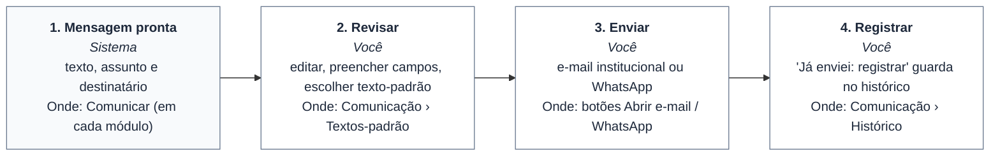

*Cores: verde, Coordenação e gestão; azul, docência; âmbar, setores; cinza, o próprio sistema.*

### Passo a passo

**Enviar o resumo semanal aos docentes** (Coordenação)

1. Na sexta-feira, em Comunicação, abra "Mensagens periódicas".
2. Confira o texto de cada docente (aulas, mudanças e prazos), copie ou abra no e-mail/WhatsApp e envie.
3. Clique em "Já enviei: registrar": o docente sai da fila da semana.

**Enviar uma mensagem avulsa** (Coordenação)

1. Em Comunicação, escolha um texto-padrão: os destinatários sugeridos já vêm marcados (você pode mudar).
2. Marque os destinatários: grupos e setores, grupos de docentes ou pessoas.
3. Preencha os campos do texto (turma, disciplina, data e hora têm listas e seletores).
4. Clique em "Gerar mensagens": sai uma caixa por destinatário. Copie ou abra no e-mail/WhatsApp, envie e registre.

**Criar ou editar um texto-padrão** (Coordenação)

1. Em Comunicação › Textos-padrão, clique em "Novo texto-padrão" ou edite um existente.
2. Escolha o tipo de interação, os destinatários sugeridos, o assunto e o texto.
3. Use os botões de variáveis para inserir campos como {{data}}; a página explica como cada campo é preenchido.

**Cadastrar o e-mail de um setor** (Coordenação)

1. Em Comunicação, na seção de grupos e setores, informe o e-mail institucional e a saudação ("prezados(as) colegas da Assistência Estudantil").
2. As próximas mensagens já saem com o destinatário e a saudação.

### Telas

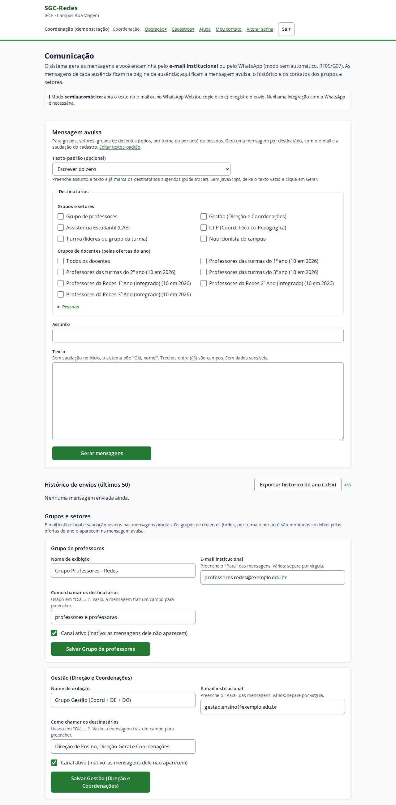

*Mensagem avulsa: texto-padrão, vários destinatários e campos com listas e datas.*

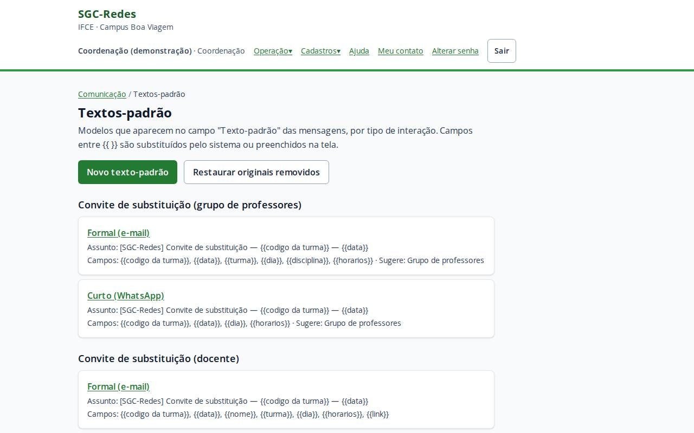

*Textos-padrão editáveis, por tipo de interação.*

### Dúvidas frequentes

- **O sistema envia as mensagens sozinho?** Não, por padrão. Ele prepara e você envia: assim nada sai sem revisão. O envio automático pelo WhatsApp depende de configuração da TI.
- **O que significa um campo entre chaves, como {{nome}}?** É um campo a preencher. Use "Substituir no texto" na caixa da mensagem ou edite à mão antes de enviar.

## 7. PPE / PEI

Progressão Parcial de Estudos: registro, modalidade, Plano de Estudo Individual e impressão.

No sistema: `/ppe`.

### O que você pode fazer

- Registrar, por semestre, os estudantes e os componentes em PPE (Coordenação).
- Alertar retenção quando o estudante tem 3 ou mais componentes pendentes (Art. 115).
- O docente da disciplina define a modalidade: PEI ou Dependência (Arts. 117–118).
- Preencher o PEI no modelo do campus, com trava de 30% da carga horária (Art. 117 §1º) e prática obrigatória quando a disciplina exige (Art. 121).
- Cronograma de encontros, com cópia de outro PEI da mesma disciplina (G09).
- Marcar os encontros realizados: a tela inicial do docente lembra os que já passaram e avisa quando é hora de lançar o resultado (fim do cronograma ou do prazo prorrogado).
- A Coordenação vê na tela inicial as PPE com resultado à espera do lançamento no sistema acadêmico (Art. 125) e as que aguardam o docente.
- Acompanhar a situação: em andamento, prorrogado, aprovado, reprovado, lançado no acadêmico. Imprimir o PEI.
- Visível também à CTP e ao Conselho de Classe (Art. 127).
- Mensagens prontas de cada momento (Coordenação): pedir ao docente a definição da modalidade; avisar estudante e CTP da modalidade, do PEI pronto (com o cronograma de encontros), da prorrogação do prazo (Art. 124) e do resultado. Ao prorrogar, a Coordenação vai direto às mensagens.

### Fluxo: Ciclo da PPE

```mermaid
flowchart LR
  classDef gestao fill:#e8f5ea,stroke:#237a32,color:#1b5e27
  classDef docencia fill:#e8f0fb,stroke:#1d5fb8,color:#174a8f
  classDef setor fill:#fffbeb,stroke:#d97706,color:#78350f
  classDef sistema fill:#f8fafc,stroke:#64748b,color:#1e293b
  classDef todos fill:#ffffff,stroke:#64748b,color:#1e293b
  E0["<b>1. Registro</b><br/><i>Coordenação</i><br/>estudante e componente pendente<br/>Onde: PPE / PEI › Registrar"]:::gestao
  E1["<b>2. Modalidade</b><br/><i>Professor</i><br/>PEI ou Dependência (aparece na tela inicial do docente)<br/>Onde: Minhas PPE / PEI"]:::docencia
  E0 --> E1
  E2["<b>3. PEI</b><br/><i>Professor</i><br/>objetivos, conteúdos, carga e encontros<br/>Onde: PPE › detalhe"]:::docencia
  E1 --> E2
  E3["<b>4. Encontros</b><br/><i>Professor</i><br/>marca os realizados; a tela inicial lembra os que já passaram<br/>Onde: PPE › Encontros realizados"]:::docencia
  E2 --> E3
  E4["<b>5. Resultado</b><br/><i>Professor</i><br/>aprovado ou reprovado ao fim do cronograma (ou prorrogação, Art. 124)<br/>Onde: PPE › Situação"]:::docencia
  E3 --> E4
  E5["<b>6. Comunicar</b><br/><i>Coordenação</i><br/>estudante e CTP recebem o resultado<br/>Onde: PPE › Comunicar"]:::gestao
  E4 --> E5
  E6["<b>7. Lançamento</b><br/><i>Coordenação</i><br/>lança no acadêmico e marca aqui (Art. 125)<br/>Onde: PPE / PEI"]:::gestao
  E5 --> E6
```

*Cores: verde, Coordenação e gestão; azul, docência; âmbar, setores; cinza, o próprio sistema.*

### Passo a passo

**Registrar uma PPE** (Coordenação)

1. Em PPE / PEI, clique em "Registrar PPE".
2. Informe semestre, estudante, matrícula e componente.
3. Com 3 ou mais componentes no semestre, o sistema mostra o alerta de retenção.

**Definir a modalidade e preencher o PEI** (Professor)

1. Em PPE / PEI aparecem as PPEs das disciplinas que você leciona.
2. Abra o registro e escolha PEI ou Dependência.
3. No PEI, preencha carga horária (até 30% da disciplina), horas presenciais e práticas, objetivos, conteúdos, critérios e o cronograma.
4. Salve e use "Imprimir" para gerar o documento para assinatura.

**Acompanhar e encerrar o PEI** (Professor)

1. Depois de cada encontro, abra a PPE e marque-o em "Encontros realizados". A tela inicial lembra os encontros que já passaram sem marca.
2. Ao fim do cronograma (ou do prazo prorrogado, Art. 124), a tela inicial mostra "PEI prontos para lançar o resultado".
3. Em "Situação", escolha Aprovado ou Reprovado e informe a nota, se houver.
4. A Coordenação avisa o estudante e a CTP e, depois de lançar no sistema acadêmico, marca "Lançado no acadêmico" (Art. 125).

**Comunicar a PPE** (Coordenação)

1. Abra a PPE e clique em "Ver mensagens prontas": o sistema escolhe o texto do momento (definir modalidade, modalidade definida, PEI pronto ou resultado).
2. Aguardando o docente: a mensagem vai para quem leciona a disciplina no ano, sem o nome do estudante.
3. Depois: uma mensagem para o estudante (digite o e-mail dele ou escolha o contato no WhatsApp) e outra para a CTP.
4. Registre cada envio. Quando a PPE muda de momento, as mensagens mudam e podem ser enviadas de novo.

### Telas

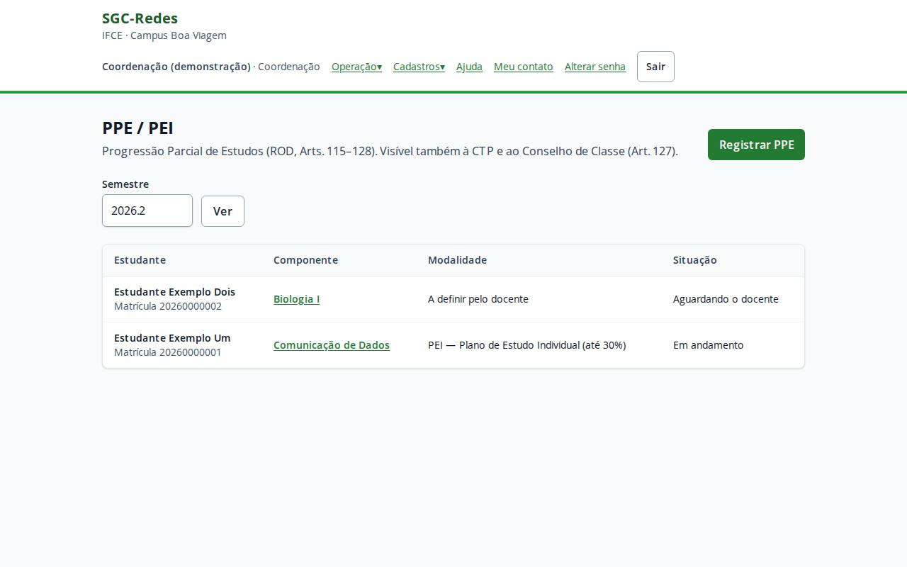

*PPEs do semestre e alertas de retenção.*

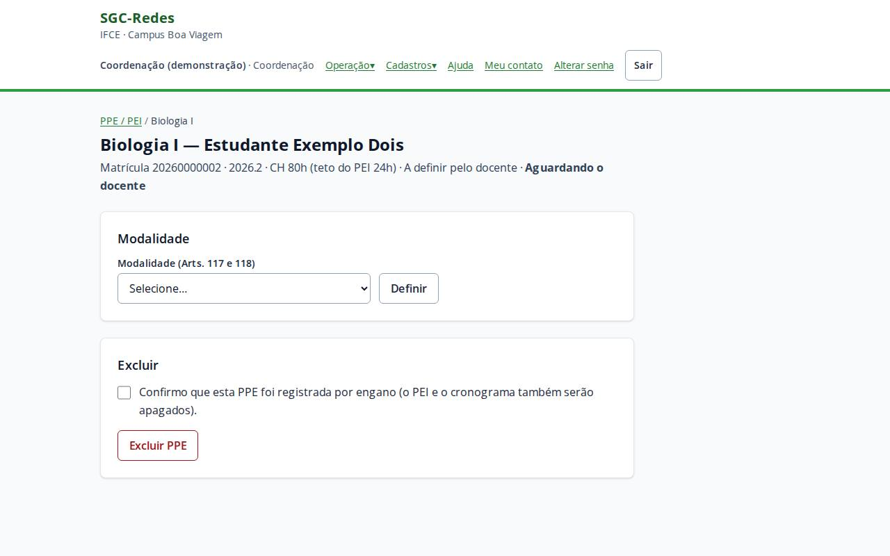

*Plano de Estudo Individual no modelo do campus.*

### Dúvidas frequentes

- **O sistema não deixa salvar o PEI.** Confira a carga horária: o PEI não pode passar de 30% da carga da disciplina, e disciplinas com prática exigem horas práticas.
- **Vários estudantes na mesma disciplina precisam de PEI.** É um PEI por estudante. Preencha o primeiro e copie o cronograma para os demais.

## 8. PPI (40 horas)

Lançamento e auditoria das atividades da Prática Profissional Integrada, com os tetos do Manual 2022.

No sistema: `/ppi`.

### O que você pode fazer

- Abrir a solicitação de PPI de um estudante e lançar as atividades com comprovante (só a Coordenação, G11).
- Aplicar automaticamente os tetos de quantidade e de horas de cada uma das 32 categorias dos 6 grupos.
- Impedir que o mesmo certificado conte duas vezes na solicitação.
- Mostrar o progresso até as 40 horas e marcar a solicitação como em análise, deferida ou indeferida.
- Gerar a ficha "Solicitação de Prática Profissional Integrada" para assinatura.
- Ao deferir ou indeferir, abrir as mensagens prontas para o estudante e a CTP (e-mail ou WhatsApp), com as horas e o motivo.

### Fluxo: Auditoria de PPI

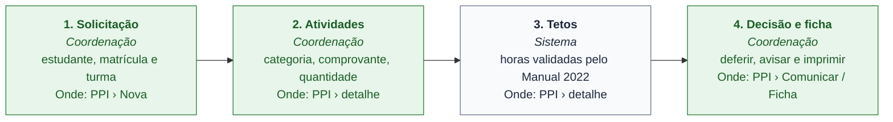

*Cores: verde, Coordenação e gestão; azul, docência; âmbar, setores; cinza, o próprio sistema.*

### Passo a passo

**Auditar uma solicitação** (Coordenação)

1. Em PPI, clique em "Nova solicitação" ou busque o estudante por nome ou matrícula.
2. Em "Lançar atividade", escolha a categoria, informe o comprovante, o código do certificado, a data e a quantidade.
3. O sistema calcula as horas validadas respeitando os tetos; acompanhe o total até 40h.
4. Atualize a situação e gere a ficha para assinatura.

**Avisar o estudante e a CTP da decisão** (Coordenação)

1. Ao deferir ou indeferir, o sistema abre "Comunicar a decisão da PPI" (o link também fica no topo da solicitação).
2. Na caixa do estudante, digite o e-mail dele (estudantes não têm cadastro) ou abra no WhatsApp e escolha o contato.
3. A mensagem da CTP já vem com o e-mail do grupo cadastrado em Comunicação.
4. Depois de enviar, clique em "Já enviei: registrar" para guardar no histórico.

### Telas

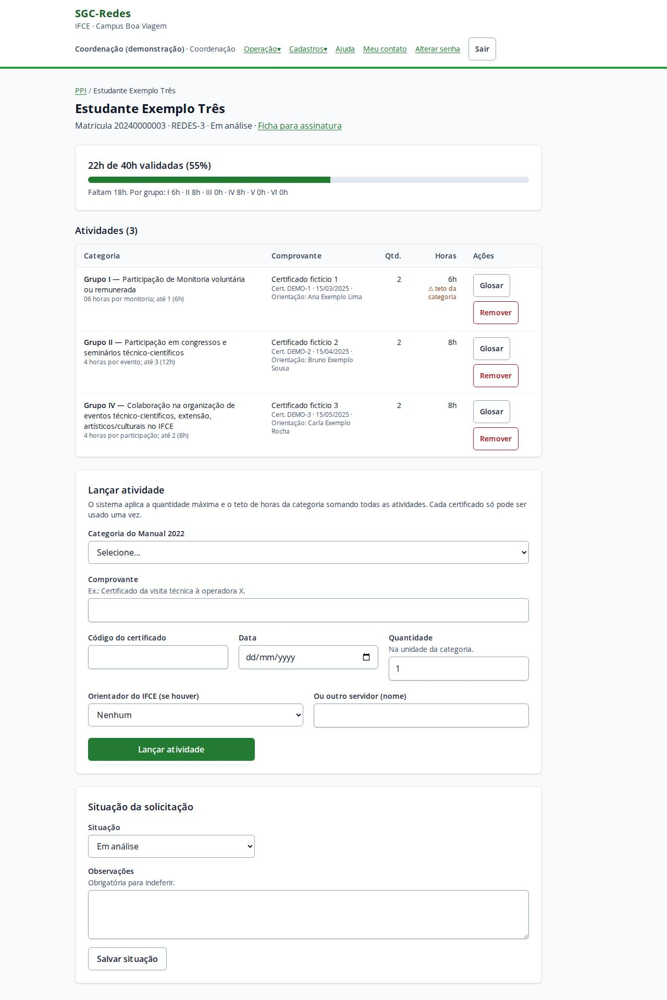

*Solicitação de PPI: atividades, horas validadas e progresso até 40h.*

### Dúvidas frequentes

- **Lancei 10 horas e o sistema validou menos.** Cada categoria tem teto de quantidade e de horas (Manual 2022); o excedente não conta.

## 9. Diários

Aulas dadas presumidas pela grade e pelo calendário, correção das exceções, conferência por amostra e lembrete ao docente.

No sistema: `/diarios`.

### O que você pode fazer

- Ver, por oferta (turma × disciplina × professor), as aulas previstas e ministradas e a situação do diário.
- As aulas ministradas são presumidas pela grade nos dias letivos já decorridos (etiqueta "automático"): o docente não precisa lançar nada, e só as exceções são corrigidas.
- Corrigir o valor (ele passa a "manual") e voltar ao automático quando a exceção acabar.
- Conferir por amostra com o diário do sistema acadêmico, em "Conferir com o sistema acadêmico".
- Ordenar do que precisa de atenção ao que está em dia (semáforo); amarelo também quando a grade não comporta as aulas previstas até o fim do período.
- Registrar a situação do diário e enviar lembrete ao docente por e-mail ou WhatsApp (Coordenação).
- O professor vê os próprios diários.

### Fluxo: Acompanhar os diários

```mermaid
flowchart LR
  classDef gestao fill:#e8f5ea,stroke:#237a32,color:#1b5e27
  classDef docencia fill:#e8f0fb,stroke:#1d5fb8,color:#174a8f
  classDef setor fill:#fffbeb,stroke:#d97706,color:#78350f
  classDef sistema fill:#f8fafc,stroke:#64748b,color:#1e293b
  classDef todos fill:#ffffff,stroke:#64748b,color:#1e293b
  E0["<b>1. Datas do semestre</b><br/><i>Coordenação</i><br/>base para as aulas esperadas (a tela inicial avisa se faltar)<br/>Onde: Calendário › Etapas"]:::gestao
  E1["<b>2. Aulas presumidas</b><br/><i>Sistema</i><br/>grade × dias letivos até ontem, menos as dispensas sem reposição<br/>Onde: Diários"]:::sistema
  E0 --> E1
  E2["<b>3. Conferência</b><br/><i>Coordenação</i><br/>por amostra, com o acadêmico; diferença vira valor manual<br/>Onde: Diários › Conferência"]:::gestao
  E1 --> E2
  E3["<b>4. Semáforo</b><br/><i>Sistema</i><br/>em dia, atenção (grade curta) ou atrasado (marcado pela Coordenação)<br/>Onde: Diários"]:::sistema
  E2 --> E3
  E4["<b>5. Lembrete</b><br/><i>Coordenação</i><br/>mensagem pronta ao docente, registrada<br/>Onde: Diários › disciplina"]:::gestao
  E3 --> E4
  E5["<b>6. Lançamento</b><br/><i>Professor</i><br/>atualiza o diário no acadêmico; vê os seus em Meus diários<br/>Onde: Meus diários"]:::docencia
  E4 --> E5
```

*Cores: verde, Coordenação e gestão; azul, docência; âmbar, setores; cinza, o próprio sistema.*

### Passo a passo

**Conferir os diários por amostra** (Coordenação)

1. Em Diários, abra "Conferir com o sistema acadêmico".
2. Compare o presumido com o número do diário no acadêmico e digite o valor de cada disciplina da amostra.
3. Clique em "Conferir": valor igual mantém o automático; diferente vira manual. Marque "em dia" conforme o acadêmico.

**Cobrar um diário atrasado** (Coordenação)

1. Em Diários, abra a oferta em atenção.
2. Atualize a situação, se for o caso.
3. Em "Lembrete ao docente", copie a mensagem pronta, envie e registre.

### Telas

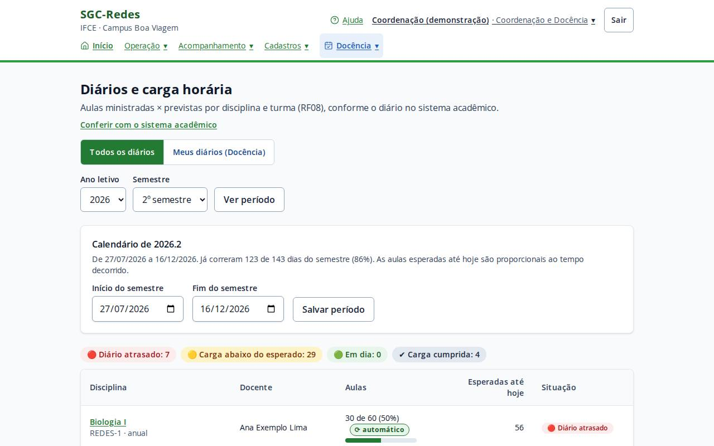

*Semáforo de diários.*

### Dúvidas frequentes

- **De onde vêm as aulas previstas?** Da grade e das datas dos semestres cadastradas no calendário.
- **O docente precisa lançar as aulas?** Não. As aulas são presumidas dadas pela grade; só as exceções (ausências, dispensas sem reposição) mudam o valor. A aula de hoje só conta a partir de amanhã.

## 10. Processos SEI

Quadro (kanban) de processos e atendimentos: aproveitamentos, transferências, estágios e mediações.

No sistema: `/processos`.

### O que você pode fazer

- Acompanhar processos em 4 colunas: Novo, Com professor, Aguardando retorno, Concluído.
- Registrar número SEI, prazo, tipo (etiqueta) e descrição.
- Filtrar por etiqueta e mover os cartões entre colunas.
- Marcar itens sigilosos (orientação e mediação), visíveis só à Coordenação.

### Fluxo: Colunas do quadro

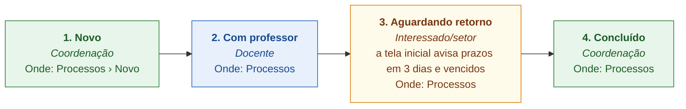

*Cores: verde, Coordenação e gestão; azul, docência; âmbar, setores; cinza, o próprio sistema.*

### Passo a passo

**Cadastrar e acompanhar um processo** (Coordenação)

1. Em Processos SEI, clique em "Novo item".
2. Informe título, tipo, número SEI, prazo e, se preciso, marque "sigiloso".
3. Mova o cartão de coluna conforme o andamento.

### Telas

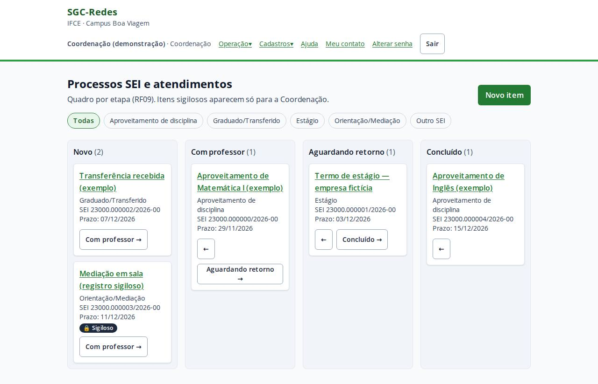

*Quadro de processos SEI.*

### Dúvidas frequentes

- **A CTP vê os itens sigilosos?** Não. Itens sigilosos aparecem só para a Coordenação (Art. 22, VIII).

## 11. Relatórios

Números consolidados de ausências, cobertura, alimentação, PPE e PPI, em tela, PDF e planilha.

No sistema: `/relatorios`.

### O que você pode fazer

- Ausências por mês: aulas perdidas, substituídas, adiantadas, dispensadas, sem decisão e taxa de cobertura.
- Avisos de refeição por urgência; PPE por situação e alertas de retenção; PPI por situação e metas atingidas.
- Só números agregados, sem nomes de estudantes nem motivos (LGPD).
- Imprimir/salvar em PDF e exportar em planilha.

### Fluxo: Gerar um relatório

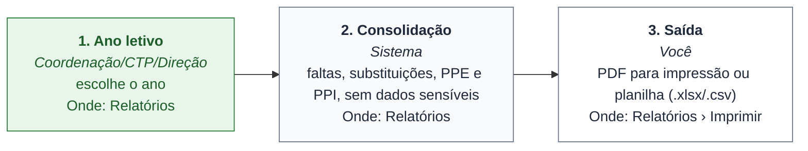

*Cores: verde, Coordenação e gestão; azul, docência; âmbar, setores; cinza, o próprio sistema.*

### Passo a passo

**Gerar o relatório do ano** (Coordenação, CTP e Direção)

1. Em Relatórios, escolha o ano e clique em "Ver".
2. Use "Imprimir / PDF" ou "Exportar planilha".

### Telas

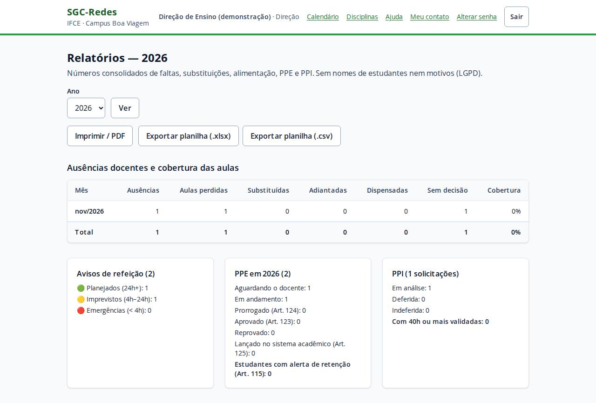

*Relatório consolidado do ano.*

## 12. Cadastros: usuários, turmas, disciplinas e ofertas

Base do sistema: pessoas, turmas, matriz curricular e distribuição das disciplinas aos professores.

No sistema: `/usuarios`.

### O que você pode fazer

- Usuários: cadastrar um a um (com máscara de telefone) ou em lote por planilha; gerar senha provisória; desativar (encerra as sessões na hora).
- Turmas: código, ano do curso, estudantes ativos e médias de refeição.
- Disciplinas: matriz curricular com núcleo, ano, semestre, carga horária, exigência de prática e programa; importação por planilha.
- Ofertas: distribuir as disciplinas de cada turma aos professores por ano letivo, pela tela ou por planilha (o modelo já traz a matriz).

### Fluxo: Ordem dos cadastros no início do ano

```mermaid
flowchart LR
  classDef gestao fill:#e8f5ea,stroke:#237a32,color:#1b5e27
  classDef docencia fill:#e8f0fb,stroke:#1d5fb8,color:#174a8f
  classDef setor fill:#fffbeb,stroke:#d97706,color:#78350f
  classDef sistema fill:#f8fafc,stroke:#64748b,color:#1e293b
  classDef todos fill:#ffffff,stroke:#64748b,color:#1e293b
  E0["<b>1. Usuários</b><br/><i>Coordenação</i><br/>professores, setores e quem também leciona<br/>Onde: Cadastros › Usuários"]:::gestao
  E1["<b>2. Turmas</b><br/><i>Coordenação</i><br/>confere estudantes e médias<br/>Onde: Cadastros › Turmas"]:::gestao
  E0 --> E1
  E2["<b>3. Disciplinas</b><br/><i>Coordenação</i><br/>matriz já vem cadastrada<br/>Onde: Cadastros › Disciplinas"]:::gestao
  E1 --> E2
  E3["<b>4. Ofertas</b><br/><i>Coordenação</i><br/>professor de cada disciplina (a tela inicial conta as que faltam)<br/>Onde: Cadastros › Ofertas"]:::gestao
  E2 --> E3
  E4["<b>5. Grade</b><br/><i>Coordenação</i><br/>horários do semestre<br/>Onde: Operação › Grade"]:::gestao
  E3 --> E4
  E5["<b>6. Calendário</b><br/><i>Coordenação</i><br/>etapas, semestres, eventos e sábados<br/>Onde: Calendário › Etapas"]:::gestao
  E4 --> E5
```

*Cores: verde, Coordenação e gestão; azul, docência; âmbar, setores; cinza, o próprio sistema.*

### Passo a passo

**Cadastrar professores em lote** (Coordenação)

1. Em Usuários, clique em "Importar planilha" e baixe o modelo.
2. Preencha nome, e-mail institucional, perfil, SIAPE e WhatsApp (opcionais). O sistema aceita .xlsx e .csv (separado por ponto e vírgula, vírgula ou tabulação).
3. Envie, confira a prévia e confirme. As senhas provisórias aparecem uma única vez, com opção de baixar.

**Distribuir as disciplinas do ano** (Coordenação)

1. Em Ofertas, escolha o ano e clique em "Distribuir disciplinas" da turma.
2. Escolha o professor de cada disciplina e salve. Ou use "Importar planilha": o modelo já traz as disciplinas da matriz de cada turma.

### Telas

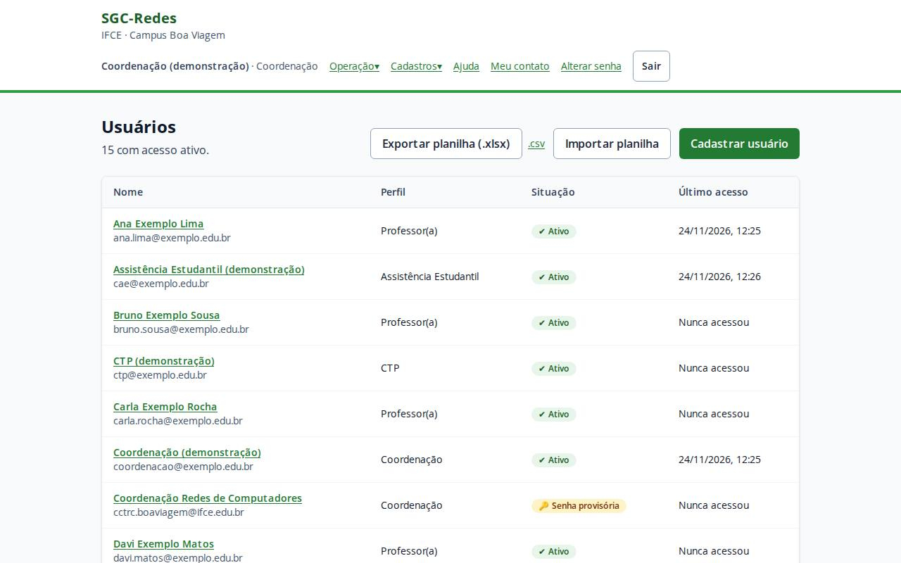

*Usuários do sistema.*

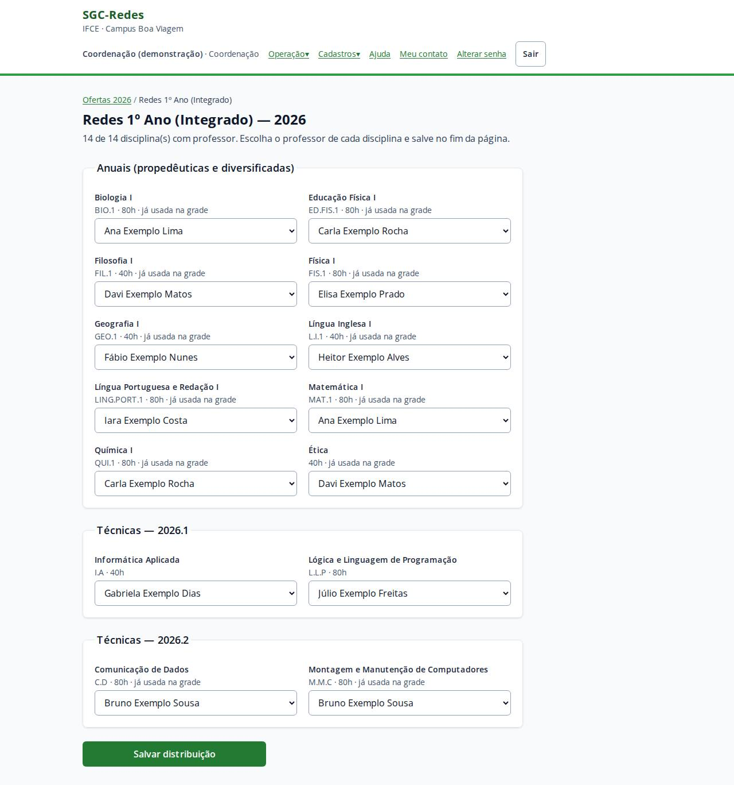

*Distribuição das disciplinas aos professores.*

### Dúvidas frequentes

- **Como desligo o acesso de quem saiu do campus?** Em Usuários, abra a pessoa e desative. O histórico continua, mas o acesso é encerrado na hora.

## 13. Planilhas, impressão e PDF

Importar e exportar dados em planilha e gerar PDF do calendário, das grades e dos relatórios.

### O que você pode fazer

- Exportar em .xlsx ou .csv: usuários, turmas, disciplinas, ofertas, grade, calendário, ausências, relatórios e histórico de comunicação (conforme o perfil).
- Importar por planilha, sempre com prévia antes de gravar: usuários, disciplinas, ofertas, grade, calendário e sábados letivos.
- O formato de exportação é o mesmo da importação: baixe, edite e envie de volta.
- Imprimir ou salvar em PDF: calendário do ano, grades (uma turma ou todas), relatórios, PEI e ficha de PPI.
- Exportações com dados pessoais ficam registradas na auditoria.

### Fluxo: Importação com prévia

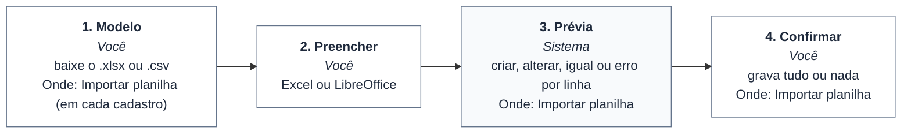

*Cores: verde, Coordenação e gestão; azul, docência; âmbar, setores; cinza, o próprio sistema.*

### Passo a passo

**Salvar em PDF** (Todos)

1. Clique em "Imprimir / PDF" na página desejada.
2. No navegador, use Ctrl+P e escolha "Salvar como PDF". A orientação (retrato/paisagem) já vem ajustada.

**Importar uma planilha** (Coordenação)

1. Abra "Importar planilha" no módulo e baixe o modelo (ele já vem pré-preenchido quando possível).
2. Preencha e envie o arquivo (até 1 MB e 500 linhas).
3. Confira a prévia: linhas com erro explicam o que corrigir; nada é gravado enquanto houver erro.
4. Clique em "Confirmar importação".

### Telas

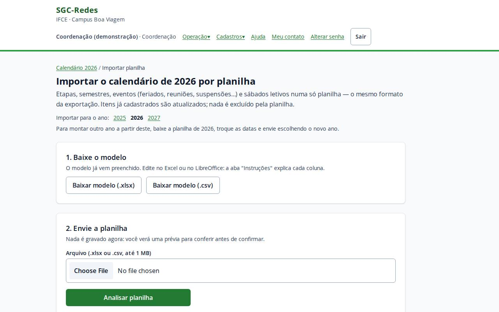

*Importação com prévia (exemplo: calendário).*

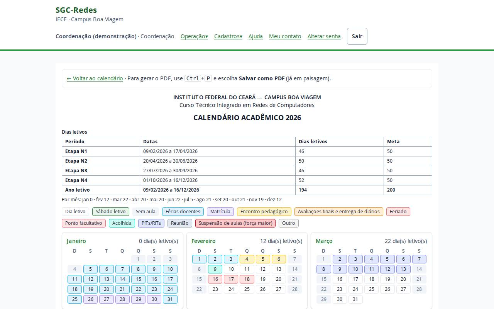

*Versão para impressão/PDF do calendário.*

### Dúvidas frequentes

- **Meu CSV dá "Faltam colunas obrigatórias".** Use os títulos de coluna do modelo. O sistema aceita CSV separado por ponto e vírgula, vírgula ou tabulação, e arquivos do Excel em português.
- **A importação apaga o que não está na planilha?** Não, exceto na grade com o modo "Substituir", que vale só para as turmas presentes na planilha.

## 14. Privacidade, segurança e auditoria

Como o sistema protege os dados (LGPD) e o que fica registrado na auditoria.

### O que você pode fazer

- Cada perfil vê só o necessário (minimização de dados): a Assistência Estudantil, por exemplo, vê apenas refeições.
- Mensagens e registros usam motivos operacionais, sem dados médicos ou pessoais.
- Senhas guardadas com criptografia forte; sessões expiram após 8 horas sem uso.
- Auditoria (Coordenação): quem fez o quê e quando — logins, cadastros, alterações, envios e exportações —, sem guardar nomes ou senhas no registro.

### Fluxo: Proteção dos dados em cada ação

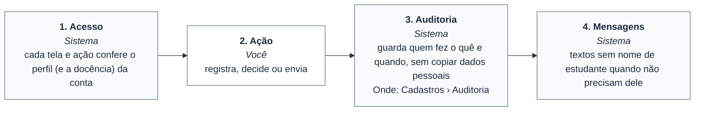

*Cores: verde, Coordenação e gestão; azul, docência; âmbar, setores; cinza, o próprio sistema.*

### Passo a passo

**Consultar a auditoria** (Coordenação)

1. Em Cadastros › Auditoria, filtre por ação, usuário e período.
2. Cada linha mostra data, usuário, ação e os campos alterados.

### Telas

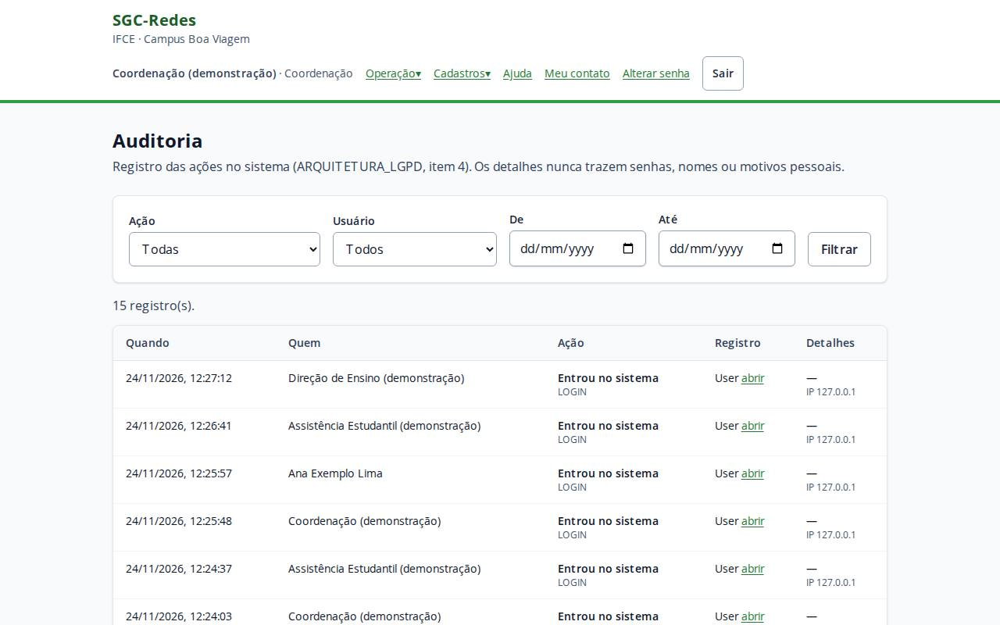

*Registros de auditoria.*

### Dúvidas frequentes

- **Posso compartilhar uma planilha exportada?** Planilhas com dados pessoais devem ficar só com quem precisa delas para o trabalho e ser apagadas quando não forem mais necessárias.

## 15. Quem vê o quê

| Módulo | Coordenação | Professor(a) | CTP | Direção | Assistência Estudantil |
| :--- | :---: | :---: | :---: | :---: | :---: |
| Calendário acadêmico | ✔ | ✔ | ✔ | ✔ | ✔ |
| Grade e substituições | ✔ | ✔ | — | — | — |
| Alimentação | ✔ | — | — | — | ✔ |
| Comunicação | ✔ | — | — | — | — |
| PPE / PEI | ✔ | ✔ | ✔ | — | — |
| PPI (40h) | ✔ | — | — | — | — |
| Diários | ✔ | ✔ | — | — | — |
| Processos SEI | ✔ | — | ✔ | — | — |
| Relatórios | ✔ | — | ✔ | ✔ | — |

Cadastros (usuários, turmas, disciplinas, ofertas), auditoria e mensagens são da Coordenação. Módulos: 9.
