# Guia do contribuidor — SGC-Redes

Este guia explica **como o código está organizado e como mudar o sistema com segurança**. As regras de convivência e o
fluxo de pull request estão em [CONTRIBUTING.md](../../CONTRIBUTING.md). Para entender *o que* o sistema faz, leia o
[manual do usuário](../MANUAL_DO_USUARIO.md) e a [especificação funcional](../FSD.md).

## Sumário

1. [Visão geral](#1-visão-geral)
2. [Preparar o ambiente](#2-preparar-o-ambiente)
3. [Estrutura do projeto](#3-estrutura-do-projeto)
4. [Como uma tela funciona](#4-como-uma-tela-funciona)
5. [Acesso, auditoria e LGPD](#5-acesso-auditoria-e-lgpd)
6. [Convenções do código](#6-convenções-do-código)
7. [Receita: criar um módulo novo](#7-receita-criar-um-módulo-novo)
8. [Banco de dados e migrações](#8-banco-de-dados-e-migrações)
9. [Testes](#9-testes)
10. [Documentação e Ajuda](#10-documentação-e-ajuda)
11. [Máquinas modestas e armadilhas conhecidas](#11-máquinas-modestas-e-armadilhas-conhecidas)
12. [Glossário](#12-glossário)

---

## 1. Visão geral

| Camada | Tecnologia |
| :--- | :--- |
| Aplicação | Next.js 16 (App Router, Server Components, Server Actions), React 19, TypeScript |
| Estilo | Tailwind CSS 4, cores do IFCE (`if-verde-*`) — ver [IDENTIDADE_VISUAL_UX.md](../IDENTIDADE_VISUAL_UX.md) |
| Dados | Prisma 6 + PostgreSQL 16 |
| Validação | zod 4 |
| Planilhas | ExcelJS (.xlsx) e CSV próprio |
| Testes | Vitest (regras puras); Playwright (capturas da Ajuda) |
| Implantação | Docker Compose (`db` + `migrate` + `app`), build `standalone` |

> **Atenção:** o Next.js 16 tem mudanças em relação a versões antigas. Antes de usar uma API, consulte o guia em
> `node_modules/next/dist/docs/` (veja [AGENTS.md](../../AGENTS.md)). Ex.: o antigo `middleware.ts` aqui é `src/proxy.ts`.

Princípios do projeto:

- **Complementar, não substituir** os sistemas oficiais (SUAP/Q-Acadêmico, SEI).
- **Semiautomático:** o sistema prepara mensagens e cálculos; a pessoa revisa e decide.
- **Funciona sem JavaScript** (formulários HTML + Server Actions) e com acessibilidade (WCAG/eMAG).
- **Privacidade por padrão** (LGPD): minimização por perfil e nenhum dado sensível em mensagens ou logs.

## 2. Preparar o ambiente

Requisitos: Node.js 20.9+ (recomendado 22) e PostgreSQL 16 (ou Docker).

```bash
./scripts/dev.sh tudo                     # instala, cria .env, testa e prepara o banco (nativo ou docker)
npm run db:demo -- --confirmo             # dados FICTÍCIOS de demonstração (usuários, grade, calendário…)
./scripts/dev.sh dev                      # http://localhost:3000
```

Com os dados de demonstração, entre com `coordenacao@exemplo.edu.br` (ou `ana.lima@`, `ctp@`, `direcao@`, `cae@`
`exemplo.edu.br`) e a senha `Demonstracao2026` para ver o sistema com cada perfil. **Nunca** rode `db:demo` em produção.

Outros comandos: `./scripts/dev.sh ajuda`.

## 3. Estrutura do projeto

```
prisma/
  schema.prisma            modelos e enums (comentados com os artigos do regimento/ROD)
  migrations/              SQL versionado — nunca edite uma migração publicada
  seed.ts                  dados iniciais reais do curso (turmas, matriz, blocos, regras de PPI, canais)
  demo.ts                  dados FICTÍCIOS para demonstração e capturas
src/
  proxy.ts                 checagem otimista do cookie de sessão (não é controle de acesso)
  app/
    login/                 tela de entrada
    (painel)/              área logada; layout.tsx = cabeçalho e menus por permissão
      <modulo>/page.tsx    telas (Server Components)
      <modulo>/actions.ts  Server Actions ('use server': só funções assíncronas exportadas)
      <modulo>/*.tsx       formulários cliente ('use client') com useActionState
      exportar/[listagem]  download de planilhas (Route Handler)
      ajuda/               manual do usuário dentro do sistema
  components/              componentes compartilhados (campo.tsx, caixa-mensagem.tsx, importador-planilha.tsx…)
  lib/
    auth/                  sessão, DAL (exigirUsuario/exigirPermissao), RBAC, senhas
    <dominio>/regras.ts    regras de negócio PURAS + regras.test.ts
    <dominio>/servidor.ts  consultas ao banco ('server-only')
    importacao/            colunas, planejamento e leitura de planilhas
    exportacao/            listagens exportáveis
    ajuda/                 conteúdo da Ajuda (topicos.ts) e gerador do manual
scripts/
  dev.sh                   tarefas do dia a dia
  capturar-telas.ts        capturas da Ajuda (Playwright)
  gerar-manual.ts          docs/MANUAL_DO_USUARIO.md
docs/                      especificação, arquitetura/LGPD, identidade visual, manual e este guia
```

## 4. Como uma tela funciona

```mermaid
sequenceDiagram
  participant N as Navegador
  participant P as page.tsx (Server Component)
  participant A as actions.ts (Server Action)
  participant L as src/lib (regras puras + servidor)
  participant B as PostgreSQL
  N->>P: GET /modulo
  P->>P: exigirPermissao('modulo:ver')
  P->>L: carregar dados (servidor.ts)
  L->>B: Prisma
  P-->>N: HTML pronto (funciona sem JS)
  N->>A: POST do <form> (Server Action)
  A->>A: exigirPermissao('modulo:gerenciar')
  A->>L: validar (zod) e planejar (função pura)
  A->>B: gravar em transação
  A->>B: registrarAuditoria (sem dados pessoais)
  A-->>N: estado (erros/mensagem) ou redirect
```



- **Leitura:** a página chama `exigirPermissao`, busca os dados em `src/lib/<dominio>/servidor.ts` e renderiza.
- **Escrita:** o formulário cliente usa `useActionState(acao, undefined)`; a action valida com zod, aplica regras puras,
  grava em transação, registra auditoria e chama `revalidatePath`/`redirect`.
- **Lote** (grade, distribuição, importações): o servidor monta a lista de itens do banco, lê só esses campos e roda um
  `planejar*()` puro que devolve o que criar/alterar/remover e os erros — tudo ou nada.

## 5. Acesso, auditoria e LGPD

- **Perfis:** `COORDENADOR`, `PROFESSOR`, `CTP`, `DIRECAO`, `ASSISTENCIA_ESTUDANTIL`. Permissões em
  `src/lib/auth/rbac.ts` (`PERMISSOES` e `PERMISSOES_POR_PERFIL`), testadas em `auth.test.ts`.
- **Sempre** `exigirUsuario()`/`exigirPermissao()` (`src/lib/auth/dal.ts`) no início de páginas, actions e rotas. O
  layout não é ponto seguro de controle (não re-renderiza a cada navegação).
- **Módulo no painel:** item em `MODULOS` (com `href`); **link no cabeçalho:** `LINKS` em `(painel)/layout.tsx`.
- **Auditoria:** `registrarAuditoria({ userId, acao, entidade, entidadeId, detalhes })` em toda gravação relevante. Rótulo
  da ação em `NOME_ACAO` (`src/lib/auditoria-filtros.ts`). Em `detalhes`, só ids, contagens e campos alterados.
- **Minimização:** a Assistência Estudantil vê só refeições; mensagens às turmas não trazem quantidades nem nomes;
  motivos de ausência são operacionais. Exportação com dados pessoais é auditada (`EXPORTOU_LISTAGEM`).
- Detalhes de sessão e senhas: [README](../../README.md#primeiro-acesso-e-autenticação) e [ARQUITETURA_LGPD.md](../ARQUITETURA_LGPD.md).

## 6. Convenções do código

- **Idioma:** nomes de domínio, mensagens, comentários e commits em português (`exigirPermissao`, `planejarGrade`).
- **Ids e contexto em campos ocultos**, nunca `acao.bind(null, id)` com `useActionState` (sem JS, re-render infinito).
  O `ImportadorPlanilha` aceita `ocultos={{ anoLetivo: '2026' }}` para isso.
- **Arquivo `'use server'` só exporta funções assíncronas**; constantes e tipos compartilhados vão para `src/lib`.
- **Código de servidor** importa `'server-only'`. Componentes cliente não importam Prisma, `node:crypto` ou ExcelJS —
  recebem dados prontos por props.
- **Formulários:** `Campo`, `Selecao`, `AreaTexto`, `BotaoPrimario`, `BotaoSecundario`, `Alerta` (`src/components/campo.tsx`);
  zod no servidor (`z.flattenError(...).fieldErrors`); `noValidate`; devolva os valores digitados no estado de erro.
- **Datas** como texto `AAAA-MM-DD` nas regras; no banco, `@db.Date` com `dataParaBanco`/`dataDoBanco`
  (`src/lib/ausencias/regras.ts`). Fuso: `America/Fortaleza`.
- **Regras puras** em `src/lib/**` com teste ao lado; o alias `@/` funciona no Vitest.
- **Importação:** colunas e `planejar*` em `src/lib/importacao/<entidade>.ts`; leitura em `servidor.ts`; tela com
  `ImportadorPlanilha`. O formato de exportação deve ser o mesmo da importação (ida e volta testada).
- **Mensagens prontas:** `MensagemPronta` (`src/lib/comunicacao/mensagem.ts`) exibida em `CaixaMensagem`; envio
  registrado em `LogComunicacao`. Textos-padrão iniciais em `src/lib/comunicacao/modelos.ts`.
- **Impressão/PDF:** página `/…/imprimir` com `BarraImpressao` (`@page` + `print:hidden`); nada de gerar PDF no servidor.
- **Estilo:** siga o código vizinho; classes Tailwind com os tokens do IFCE; alvos de toque `min-h-11`.

## 7. Receita: criar um módulo novo

1. **Especifique** na issue: perfis que usam, regras (com artigo do regimento/ROD) e decisões em aberto.
2. **Permissões** em `rbac.ts` (+ teste em `auth.test.ts`) e o módulo em `MODULOS` / link em `layout.tsx`.
3. **Schema e migração** (seção 8), se houver dados novos.
4. **Regras puras** em `src/lib/<modulo>/regras.ts` com `regras.test.ts`.
5. **Consultas** em `src/lib/<modulo>/servidor.ts` (`'server-only'`).
6. **Telas e actions** em `src/app/(painel)/<modulo>/`, com `exigirPermissao`, zod, transação e auditoria.
7. **Rótulo de auditoria** em `NOME_ACAO`.
8. **Exportação** (se fizer sentido) em `src/lib/exportacao/listagens.ts`.
9. **Ajuda:** tópico em `src/lib/ajuda/topicos.ts` (capacidades, fluxo, passo a passo, imagens com `captura`, dúvidas),
   `npm run manual` e `npm run capturas -- <id>`.
10. **Dados de demonstração** em `prisma/demo.ts`, para as capturas e para quem for revisar.
11. **Verifique** (seção 9) e abra o PR.

## 8. Banco de dados e migrações

- Edite só as linhas necessárias do `schema.prisma` (não rode `prisma format` no arquivo inteiro).
- Gere a migração sem precisar de banco:
  ```bash
  git show HEAD:prisma/schema.prisma > /tmp/schema_antigo.prisma
  mkdir -p prisma/migrations/AAAAMMDDHHMMSS_nome
  DATABASE_URL=postgresql://x:x@localhost:5432/x npx prisma migrate diff \
    --from-schema-datamodel /tmp/schema_antigo.prisma --to-schema-datamodel prisma/schema.prisma \
    --script > prisma/migrations/AAAAMMDDHHMMSS_nome/migration.sql
  npx prisma generate
  ```
- **Revise o SQL:** troca de coluna vira `DROP` + `ADD ... NOT NULL`, que perde dados ou falha. Reescreva convertendo
  (exemplo: `20261124150000_ofertas_ano_letivo`) e teste com dados no formato antigo.
- `npm run db:deploy` aplica; `npm run db:seed` popula o básico; `npm run db:demo -- --confirmo` adiciona a demonstração.
- O serviço `migrate` do Docker roda migrações e seed na subida; arquivos importados pelo seed precisam ser copiados no
  estágio `migrator` do `Dockerfile`.

## 9. Testes

| O quê | Como |
| :--- | :--- |
| Tipos | `npm run typecheck` |
| Regras de negócio | `npm test` (Vitest; arquivos `*.test.ts` ao lado do código) |
| Build | `NEXT_TELEMETRY_DISABLED=1 npm run build` |
| Conteúdo da Ajuda | incluído em `npm test`: tópicos, rotas, imagens e manual atualizado |
| Telas | navegador **com e sem JavaScript**, com os dados de demonstração e cada perfil relevante |

O CI (`.github/workflows/ci.yml`) roda typecheck, testes e build em cada push e pull request. Roteiros de ponta a ponta
com Playwright estão no backlog; até lá, descreva no PR o roteiro manual que você seguiu.

Boas práticas: teste a regra pura (casos de borda, erros com a mensagem que o usuário verá); para importações, teste a
**ida e volta** (exportar → importar → nada muda).

## 10. Documentação e Ajuda

| Público | Onde | Como atualizar |
| :--- | :--- | :--- |
| Usuários | Sistema → **Ajuda** (`/ajuda`, PDF em `/ajuda/manual`) e [docs/MANUAL_DO_USUARIO.md](../MANUAL_DO_USUARIO.md) | edite `src/lib/ajuda/topicos.ts`, rode `npm run manual` |
| Capturas de tela | `public/manual/*.jpg` | servidor com `db:demo` + `BASE_URL=http://localhost:3000 npm run capturas [-- id]` |
| Contribuidores | este guia e [CONTRIBUTING.md](../../CONTRIBUTING.md) | edite à mão |
| Negócio | [FSD.md](../FSD.md), [ARQUITETURA_LGPD.md](../ARQUITETURA_LGPD.md) | edite à mão; decisões novas na tabela de pendências do FSD |
| Andamento | [PROXIMOS_PASSOS.md](../PROXIMOS_PASSOS.md) | backlog e decisões |

Capturas: precisam do Chromium do Playwright (`npx playwright install chromium-headless-shell`; em distribuições não
suportadas, `PLAYWRIGHT_HOST_PLATFORM_OVERRIDE=ubuntu24.04-x64`) e de uma fonte de emoji (ex.: `fonts-noto-color-emoji`,
ou o `NotoColorEmoji.ttf` em `~/.local/share/fonts`), senão os ícones de urgência saem em branco. O servidor de produção
lê `public/` ao iniciar: reinicie-o depois de gerar imagens novas. Use **só dados fictícios**.

Ao escrever para usuários: frases curtas, nomes de botões exatamente como na tela, "você", sem jargão técnico.

## 11. Máquinas modestas e armadilhas conhecidas

- Com pouca RAM/HDD, rode comandos pesados com `nice -n 15 ionice -c 2 -n 7` e um por vez (o `dev.sh` já faz isso).
- **npm 9.2 do Debian/Ubuntu** falha com `reading 'edgesOut'`: use `npx -y npm@10 install`.
- **`/tmp` pequeno (tmpfs):** downloads grandes (Chromium) podem falhar com `ENOSPC`; use `TMPDIR=~/.cache/tmp`.
- **Postgres sem Docker para testes:** `npx prisma dev -n sgc-teste -d`; exige `&connection_limit=1&pgbouncer=true` na URL.
- **Servidor standalone:** copie `.next/static` para `.next/standalone/.next/static` e `public/` para
  `.next/standalone/public`.
- Evite `pkill -f <texto>`: pode encerrar o próprio terminal. Localize o processo pela porta (`ss -ltnp`).

## 12. Glossário

| Termo | Significado |
| :--- | :--- |
| ROD | Regulamento da Organização Didática do IFCE |
| PPE | Progressão Parcial de Estudos (ROD Arts. 115–128) |
| PEI | Plano de Estudo Individual (modalidade de PPE, até 30% da CH) |
| PPI | Prática Profissional Integrada (40 horas, Manual 2022) |
| CAE / AE | Coordenadoria de Assistência Estudantil (refeições) |
| CTP | Coordenadoria Técnico-Pedagógica |
| SEI | Sistema Eletrônico de Informações (processos) |
| Etapas N1–N4 | Quatro etapas do ano letivo (~50 dias letivos cada, 200 no ano) |
| Janela livre | Horário vago num turno em que a turma tem aula |
| G01…G14 | Decisões de negócio registradas no [FSD](../FSD.md#5-checklist-de-fechamento--sessão-grill-me-decisões-pendentes) |
