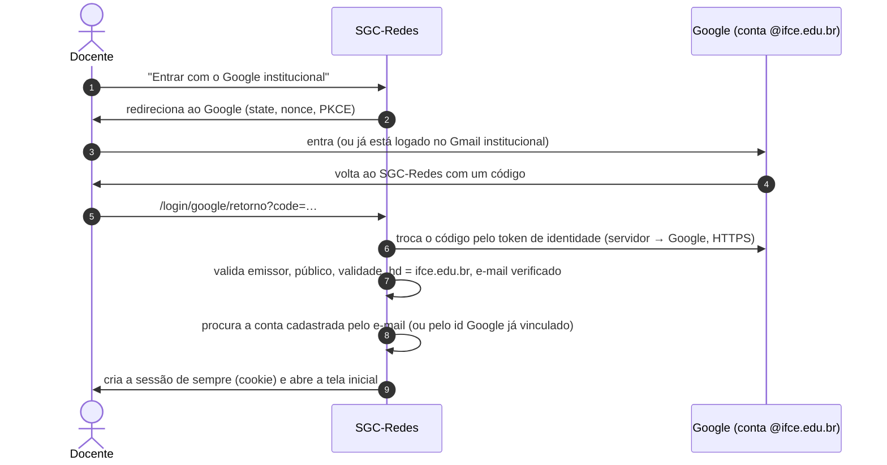

# Estudo: login institucional com o Google (SSO)

*25/11/2026. Estudo de viabilidade. Ainda não implementado.*

## 1. Conclusão

**É viável e de baixo risco técnico.** O Google Workspace do IFCE já autentica a maioria dos sistemas
institucionais, e o protocolo aberto que ele oferece (OpenID Connect) se encaixa no SGC-Redes sem trocar o
controle de acesso atual.

O Google passa a confirmar *quem é a pessoa*. O SGC-Redes continua decidindo *o que ela pode fazer*, pelo perfil e
pela docência cadastrados pela Coordenação.

O desenvolvimento leva cerca de 2 dias. Os pré-requisitos dependem da TI (DGTI ou TI do campus):
- um projeto no Google Cloud dentro da organização `ifce.edu.br`;
- credenciais OAuth do tipo "Aplicativo da Web";
- um endereço **https com nome de domínio** para o sistema, que já está pendente para o `APP_URL`.

## 2. Como funcionaria

**Regras propostas:**

1. **Só contas do domínio institucional.**
   - O sistema exige `hd = ifce.edu.br` e `email_verified = true` no token, conferidos no servidor.
   - O parâmetro da tela do Google não basta, porque pode ser burlado.
   - Contas pessoais (`@gmail.com`) e de estudantes (`@aluno.ifce.edu.br`) ficam de fora.
2. **Sem cadastro automático.**
   - Entra só quem a Coordenação já cadastrou, porque o perfil e a docência precisam ser atribuídos.
   - Uma conta institucional válida, mas não cadastrada, vê: "Seu acesso ainda não foi liberado. Fale com a
     Coordenação do curso."
3. **Vínculo estável.**
   - No primeiro login, o sistema guarda o identificador Google (`sub`) da conta.
   - Mudanças de e-mail ou apelido não quebram o acesso.
4. **A senha local fica como contingência.**
   - O login por senha continua para a Coordenação, para o caso de o Google ou a internet do campus caírem.
   - Para os demais, ele pode ser desligado (decisão G21).
   - Quem entra pelo Google não precisa da senha provisória nem trocá-la.
5. **Sair** encerra a sessão do SGC-Redes, mas não a conta Google da pessoa, como nos outros sistemas do IFCE.

## 3. O que muda no sistema

| Parte | Mudança |
| :--- | :--- |
| Banco | `User.googleSub String? @unique`. A migração só acrescenta, conforme a política de `docs/IMPLANTACAO.md`, seção 8. |
| Rotas | `/login/google`, que inicia o fluxo, e `/login/google/retorno`, que recebe a volta. As duas são públicas no `proxy.ts`. |
| Biblioteca | `openid-client` (certificada pela OpenID Foundation): descoberta, PKCE, `nonce` e validação do token. Evitar o Auth.js, que substituiria a sessão e o controle de acesso já testados. |
| Tela de login | Botão "Entrar com o Google institucional" em destaque; senha em "Outras formas de entrar". |
| Configuração | `GOOGLE_CLIENT_ID`, `GOOGLE_CLIENT_SECRET` e `GOOGLE_DOMINIO=ifce.edu.br` no `.env`. Sem elas, o botão não aparece e nada muda. |
| Auditoria | `ENTROU_GOOGLE` e `ACESSO_NEGADO_GOOGLE` (motivo: domínio, não cadastrado, desativado), sem copiar dados além do id do usuário. |
| Testes | Testes unitários da validação do token (domínio, e-mail não verificado, conta desativada). No E2E, um provedor OIDC simulado, porque o Google real não pode ser usado no CI. |

## 4. Pré-requisitos e perguntas para a TI

| # | Item | Observação |
| :--- | :--- | :--- |
| 1 | Projeto no Google Cloud **da organização ifce.edu.br** | Com a tela de consentimento do tipo **Interno**, só contas do IFCE podem entrar, e não há verificação do Google para fazer. |
| 2 | Cliente OAuth "Aplicativo da Web", com a URI de redirecionamento `https://<endereço>/login/google/retorno` | O Google exige **https** e **nome de domínio público**: não aceita IP nem `.local`. O servidor pode ficar só na rede interna, porque quem vai ao Google é o navegador. |
| 3 | Saída da VM para `accounts.google.com` e `oauth2.googleapis.com` (porta 443) | A troca do código pelo token é feita pelo servidor. |
| 4 | Entrega segura do *client secret* | Fora de e-mail e chat. Ele fica só no `.env` da VM, com `chmod 600`. |
| 5 | Os sistemas do IFCE usam o Google direto ou um provedor intermediário (Keycloak, SAML pelo Admin Console)? | Se houver um provedor central, o SGC-Redes deve usá-lo, pelo mesmo protocolo (OIDC) e com o mesmo esforço. |
| 6 | Os servidores usam só `@ifce.edu.br`, ou também subdomínios? | Define a lista de domínios aceitos. |

## 5. LGPD e segurança

- **Dados recebidos:** só os escopos `openid email profile`, isto é, identificador, e-mail, nome e domínio. Nenhum
  acesso a Drive, Gmail ou Agenda.
- **Termo de uso:** o aviso de privacidade (Ajuda › Privacidade) ganha um parágrafo sobre o login pelo Google.
- **Senhas:** ficam menos senhas locais para vazar. A segurança da conta, com verificação em duas etapas e recuperação,
  passa a ser a da conta institucional.
- **Risco principal:** perder o acesso quando o Google ou a internet caem. A senha local da Coordenação mitiga isso
  (regra 4).

## 6. Decisões pendentes

| ID | Decisão | Sugestão |
| :-- | :--- | :--- |
| G20 | Adotar o login Google institucional? | Sim, quando a TI entregar o projeto, as credenciais e o domínio público. |
| G21 | A senha local continua para todos ou só para a Coordenação? | Só para a Coordenação, como contingência; os demais entram pelo Google. |
| G22 | Cadastro automático de quem entra pelo Google? | Não: só contas cadastradas pela Coordenação, porque o perfil e a docência precisam ser atribuídos. |
